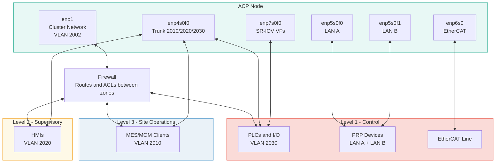
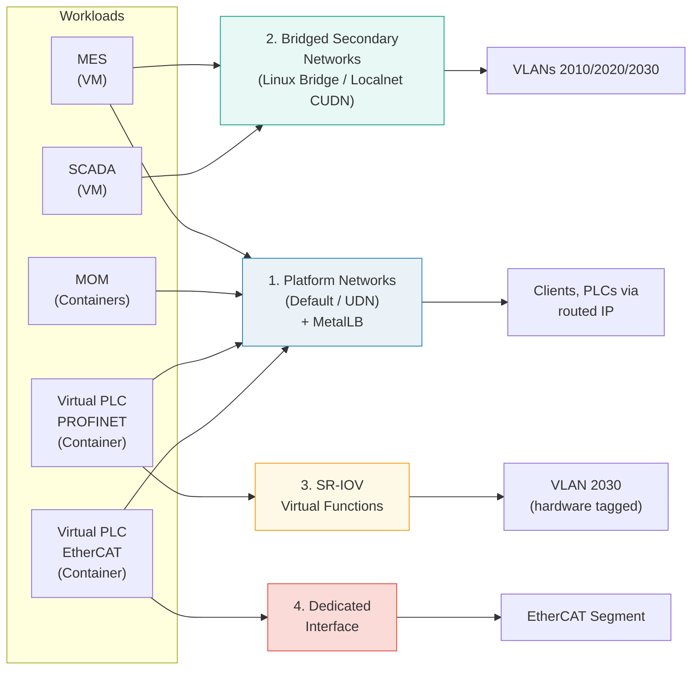
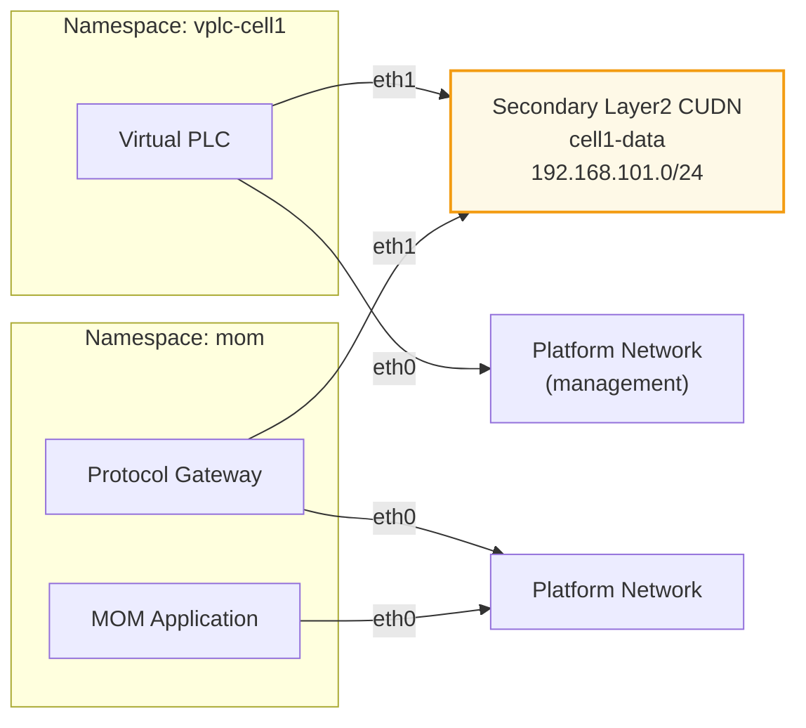
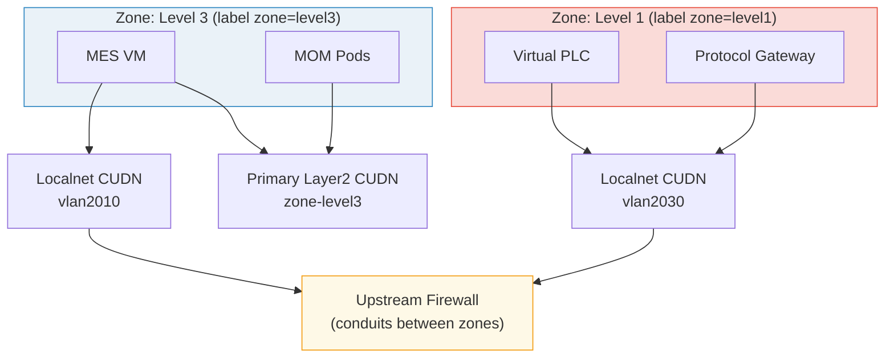
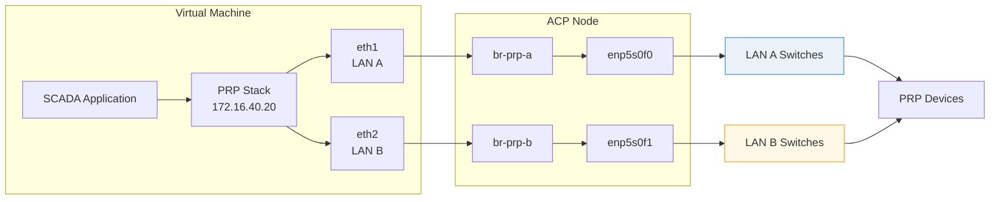
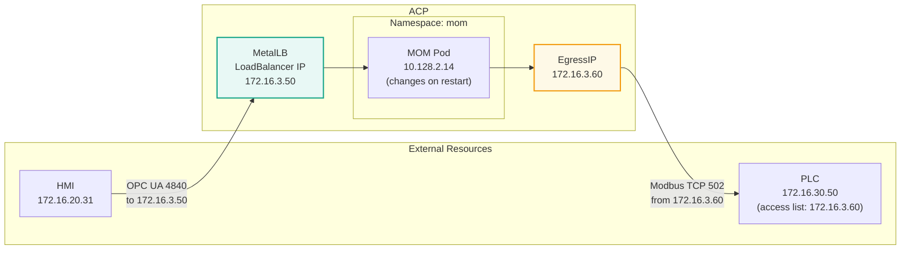
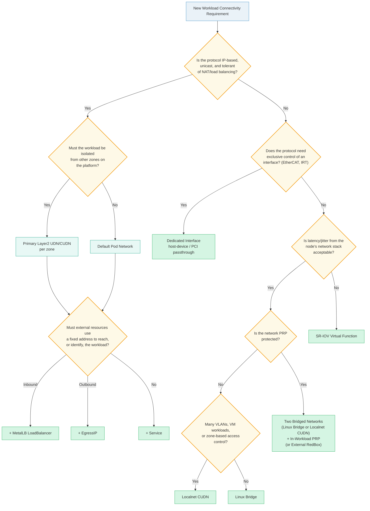

# Industrial Connectivity for Workloads on an ACP
This pattern gives a technical look at how industrial workloads, such as manufacturing execution systems (MES), manufacturing operations management (MOM) systems, SCADA systems, and virtual PLCs, running as virtual machines or containers on an ACP, can be connected to the industrial networks and devices they depend on. It outlines the connectivity models available on the platform, including where user defined networks (`UserDefinedNetwork` and `ClusterUserDefinedNetwork`) fit within them, maps common industrial protocols such as PROFINET, EtherNet/IP, EtherCAT, and PRP to those models, and covers the use of the platform's load balancing service (MetalLB) to keep the IP addresses that external resources depend on consistent.

## Table of Contents
* [Abstract](#abstract)
* [Problem](#problem)
* [Context](#context)
* [Forces](#forces)
* [Solution](#solution)
* [Resulting Content](#resulting-context)
* [Examples](#examples)
* [Rationale](#rationale)

## Abstract
| Key | Value |
| --- | --- |
| **Platform(s)** | Red Hat OpenShift |
| **Scope** | <ul><li>Networking</li><li>Virtualization</li></ul> |
| **Tooling** | <ul><li>Red Hat OpenShift GitOps</li></ul> |
| **Pre-requisite Blocks** | <ul><li>[Example ACP Networking](../../blocks/example-network-config/README.md)</li><li>[ACP Network Configuration](../../blocks/acp-network-configuration/README.md)</li><li>[Creating Bridged Networks on an ACP](../../blocks/acp-bridged-networks/README.md)</li></ul> |
| **Pre-requisite Patterns** | <ul><li>[ACP Standard Architecture](../acp-standardized-architecture-ha/README.md)</li><li>[Industrial Edge Platform Overview](../industrial-edge-platform/README.md)</li><li>[Bridging Virtual Machines Directly to a Network](../virtualization-networking-bridged/README.md)</li></ul> |
| **Example Application** | N/A |

## Problem
**Problem Statement:** Workloads at industrial sites do not only speak "IT" protocols. Alongside web interfaces and databases, they communicate with PLCs, drives, I/O, and other devices on the plant floor using industrial protocols, many of which are not routable, are sensitive to latency and jitter, rely on multicast or broadcast, expect redundant network paths, or require exclusive access to a network interface.

When these workloads are moved from dedicated industrial PCs and standalone hypervisors onto a consolidated platform, the platform must be able to provide each workload with the specific type of connectivity its protocols require, without forcing every workload into the same model. In addition, devices and systems external to the platform, such as PLCs, HMIs, firewalls, and engineering tools, are often configured with fixed IP addresses for the systems they talk to. The platform must be able to present consistent addresses to those external resources, even as the workloads behind them are restarted, rescheduled, or moved between nodes.

## Context
This pattern can be applied to ACPs at industrial sites where workloads need to communicate with industrial devices and networks, in addition to (or instead of) traditional IT networks. Both virtual machines and containers are in scope, as industrial sites typically run a mix of existing virtualized applications, such as a Windows-based MES, and newer containerized applications, such as a MOM platform, data collection services, or a virtual PLC runtime.

This pattern builds on the connectivity models covered in [Bridging Virtual Machines Directly to a Network](../virtualization-networking-bridged/README.md), and extends them with the additional models and considerations specific to industrial protocols.

A few key assumptions are made:
- The intended context of the platform aligns to the [Standard HA ACP Architecture](../acp-standardized-architecture-ha/README.md)
- The platform's placement within the site aligns to the [Industrial Edge Platform Overview](../industrial-edge-platform/README.md), typically at Level 3 of the Purdue model, with conduits down into Levels 2 and 1
- Physical connections, such as power and networking, have been made to the target hardware, including any additional NICs dedicated to industrial networks
- The upstream network configuration is completed and verified, including any separate redundant networks
- The site's zones and conduits (for example, per IEC 62443) have been defined, and determine which workloads are permitted to connect to which networks

## Forces
- **Protocol Diversity:** This pattern's solution must support protocols that range from routable, client/server TCP protocols, through layer 2 multicast protocols, through protocols that require exclusive, deterministic access to a physical interface.
- **Workload Diversity:** This pattern's solution must apply equally to virtual machines and containers, as both are commonly found side-by-side at industrial sites.
- **Address Stability:** This pattern's solution must allow external resources to reach workloads at consistent IP addresses, and must allow workloads to reach external resources from consistent IP addresses, as industrial devices and firewalls are frequently configured with fixed addresses.
- **Determinism Where Required:** This pattern's solution must allow time-sensitive workloads, such as virtual PLCs, to receive the network and compute isolation they require, without imposing that cost on every workload.
- **Redundancy:** This pattern's solution must support the redundancy approaches used on industrial networks, such as PRP, in addition to the redundancy approaches used on IT networks, such as link bonding.
- **Segmentation:** This pattern's solution must preserve the site's network segmentation, allowing workloads to be placed only on the networks their zone is permitted to reach.
- **Declarative Management:** This pattern's solution should express all connectivity as platform resources, allowing it to be managed through the same declarative tooling used for the rest of the platform.

## Solution
No single connectivity model fits every industrial protocol. Instead, the platform offers a small set of connectivity models, each with different trade-offs, and each workload (or each interface of a workload) is matched to the model that its protocols require. A single workload may use more than one model at the same time: for example, a virtual PLC may expose a web interface on the default network, while exchanging cyclic I/O on a dedicated interface.

This solution is broken down into ten main areas: an overview of common industrial protocols and their network requirements, an example site topology, an overview of the connectivity models available on the platform, detailed looks at each model (Sections 4-6), redundancy with PRP, keeping addresses consistent with MetalLB and EgressIP, platform tuning for time-sensitive workloads, and guidance on choosing a model.

### Section 1 - Industrial Protocol Characteristics
The most important question when connecting an industrial workload is not "which protocol", but "what does the protocol need from the network". The following table summarizes the characteristics of common industrial protocols that drive connectivity decisions:

| Protocol | Transport | Routable | Traffic Pattern | Typical Timing | Key Network Requirements |
| --- | --- | --- | --- | --- | --- |
| PROFINET RT | Ethernet (EtherType `0x8892`), plus UDP for connection setup | No | Cyclic I/O, layer 2 multicast for discovery (DCP) | 1ms - 512ms cycle | Same layer 2 domain as devices, stable MAC address, VLAN priority (PCP 6) |
| PROFINET IRT | Ethernet, hardware-scheduled time slots | No | Cyclic I/O in reserved bandwidth | 31.25µs - 1ms cycle | IRT-capable interface hardware and switches, hardware time synchronization |
| EtherNet/IP explicit messaging | TCP/UDP `44818` | Yes | Request/response | Non-time-critical | IP reachability |
| EtherNet/IP implicit (Class 1) I/O | UDP `2222`, unicast or multicast | Typically no (multicast TTL of 1) | Cyclic I/O at the requested packet interval (RPI) | 1ms+ RPI | Same subnet as devices, IGMP snooping/querier for multicast |
| EtherCAT | Ethernet (EtherType `0x88A4`) | No | Frames processed on-the-fly by each device in a line | 31.25µs - 10ms cycle | Exclusive physical interface, no switches between the main device and the segment, low and consistent latency |
| PRP / HSR | Redundancy layer (IEC 62439-3) beneath any Ethernet protocol | N/A | Every frame duplicated across two paths | Zero recovery time | Two independent networks (PRP) or a ring (HSR), identical MAC address on both ports |
| IEC 61850 GOOSE / Sampled Values | Ethernet (EtherTypes `0x88B8`, `0x88BA`), multicast | No | Event-driven / cyclic multicast | ≤4ms (GOOSE) | Same layer 2 domain, multicast, often paired with PRP/HSR and PTP |
| Modbus TCP | TCP `502` | Yes | Polling, request/response | 10ms+ | IP reachability, often IP-based access lists on the device |
| OPC UA (client/server) | TCP `4840` | Yes | Request/response, subscriptions | 100ms+ | IP reachability, certificates that often include the server's IP address or hostname |
| OPC UA PubSub | UDP multicast or MQTT | UDP: typically no; MQTT: yes | Publish/subscribe | Varies | Multicast on the same layer 2 domain (UDP), or a broker (MQTT) |
| MQTT / Sparkplug B | TCP `1883` / `8883` | Yes | Publish/subscribe via broker | Non-time-critical | IP reachability to the broker |
| S7 Communication | TCP `102` (ISO-on-TCP) | Yes | Request/response | Non-time-critical | IP reachability, often permitted partner lists on the device |
| BACnet/IP | UDP `47808` | Partially (via BBMD) | Broadcast discovery, request/response | Non-time-critical | Same layer 2 domain for broadcasts |
| PTP (IEEE 1588) | Ethernet or UDP `319`/`320` | Depends on profile | Time synchronization | Sub-microsecond accuracy | Interfaces with hardware timestamping |

These characteristics sort the protocols into four broad groups, which map directly to the platform's connectivity models:

| Group | Characteristics | Example Protocols |
| --- | --- | --- |
| **Routable Client/Server** | IP-based, unicast, tolerant of NAT and load balancing, non-time-critical | OPC UA, MQTT, Modbus TCP, EtherNet/IP explicit, S7 communication, HTTP/REST |
| **Layer 2 Native** | Requires presence on the same layer 2 domain as devices, uses multicast/broadcast or non-IP EtherTypes, stable MAC addresses | PROFINET RT, EtherNet/IP implicit I/O, GOOSE, BACnet/IP, OPC UA PubSub over UDP |
| **Hardware-Bound / Deterministic** | Requires exclusive or hardware-assisted access to an interface, tight timing | EtherCAT, PROFINET IRT, PTP with hardware timestamping |
| **Redundancy** | Changes how frames are carried, beneath any of the above | PRP, HSR |

### Section 2 - Example Site Topology
The following example topology will be used throughout this pattern. It extends the VLANs used in other patterns and blocks with additional industrial networks:

| VLAN | Subnet | Description |
| --- | --- | --- |
| 2000 | 172.16.0.0/24 | Out of band management interfaces of hardware |
| 2001 | 172.16.1.0/24 | Hyperconverged storage network |
| 2002 | 172.16.2.0/23 | Cluster primary network for ingress, load balanced services, and MetalLB pools |
| 2010 | 172.16.10.0/24 | Level 3 - Site operations network (MES/MOM clients, historians, engineering workstations) |
| 2020 | 172.16.20.0/24 | Level 2 - Supervisory network (SCADA, HMIs) |
| 2030 | 172.16.30.0/24 | Level 1 - Cell/area control network (PLCs, PROFINET and EtherNet/IP devices) |
| N/A (LAN A/LAN B) | 172.16.40.0/24 | PRP-protected control network, carried on two physically independent networks |
| N/A | N/A | EtherCAT segment for a machine line, no IP addressing |

Each ACP node has the following network interfaces:
| Interface | Connected To | Purpose |
| --- | --- | --- |
| `eno1` | Switch, access VLAN 2002 | Cluster primary network |
| `eno2` | Switch, access VLAN 2001 | Storage network |
| `enp4s0f0` | Switch, trunk VLANs 2010, 2020, 2030 | Industrial workload networks, via bridges |
| `enp5s0f0` | PRP LAN A switch | PRP-protected control network, LAN A |
| `enp5s0f1` | PRP LAN B switch | PRP-protected control network, LAN B |
| `enp7s0f0` | Switch, trunk VLAN 2030 | SR-IOV capable interface, for virtual functions on the control network |
| `enp6s0` | EtherCAT segment (direct) | Dedicated EtherCAT interface, one node only |

> Note:
>
> Not every node needs every interface. Interfaces dedicated to a specific machine or line, such as the EtherCAT interface, are typically only present on one or two nodes. Node labels are used to steer workloads that need those interfaces onto the correct nodes.



### Section 3 - Connectivity Models on the Platform
The platform provides five connectivity models for workloads. They are listed roughly in order of increasing specialization: each step down the table gives the workload more direct access to the network, at the cost of flexibility.

User defined networks (`UserDefinedNetwork` and `ClusterUserDefinedNetwork`) are not a separate model. Instead, they provide declarative, namespace-scoped ways to build the first two models, and are called out as variants within them.

| Model | How It Works | Supports VMs | Supports Containers | Address Stability | Live Migration / Rescheduling | Best Fit |
| --- | --- | --- | --- | --- | --- | --- |
| **1. Platform Networks + Services** | Workload sits on a network internal to the platform: the default pod network, a primary layer2 user defined network, or a secondary layer2 user defined network. Exposed via `Service` resources, with MetalLB providing external addresses | Yes (`masquerade`, `l2bridge`, or `bridge` binding) | Yes | Via MetalLB (inbound) and EgressIP (outbound); persistent addresses within user defined networks | Yes | Routable client/server, platform-internal workload-to-workload traffic |
| **2. Bridged Secondary Networks** | Workload gets an additional interface directly on an upstream VLAN via Linux bridges or localnet `ClusterUserDefinedNetworks` | Yes | Yes | Static, reserved, or platform-managed persistent addresses, stable MACs | Yes | Layer 2 native |
| **3. SR-IOV Virtual Functions** | Workload gets a hardware virtual function of a physical NIC, bypassing the node's network stack | Yes (`vfio-pci`) | Yes (`netdevice`) | Static addresses, stable MACs | Containers: rescheduled to any SR-IOV node; VMs: validate support for the platform version | Layer 2 native with lower latency and jitter |
| **4. Dedicated Interface** | Workload is given exclusive ownership of an entire physical NIC (PCI passthrough for VMs, `host-device` for containers) | Yes | Yes | Owned entirely by the workload | No, pinned to the node with the interface | Hardware-bound / deterministic |
| **5. Host Network** | Container shares the node's network namespace | No | Yes | Node's addresses | Tied to node | Narrow, platform-level agents only; avoid for applications |

The variants within the first two models are:
| Model | Variant | Configuration Resources | Connects To | Covered In |
| --- | --- | --- | --- | --- |
| 1. Platform Networks | Default pod network | None | Platform-internal network shared by all namespaces | Section 4 |
| 1. Platform Networks | Primary layer2 `UserDefinedNetwork` / `ClusterUserDefinedNetwork` | `UserDefinedNetwork` or `ClusterUserDefinedNetwork` | Isolated, platform-internal network per zone or application, replacing the default pod network | Section 4 |
| 1. Platform Networks | Secondary layer2 `UserDefinedNetwork` / `ClusterUserDefinedNetwork` | `UserDefinedNetwork` or `ClusterUserDefinedNetwork` | Additional isolated, platform-internal layer 2 network between selected workloads | Section 4 |
| 2. Bridged Secondary Networks | Linux bridges | `NodeNetworkConfigurationPolicy`, `NetworkAttachmentDefinition` | Upstream VLANs | Section 5 |
| 2. Bridged Secondary Networks | Localnet `ClusterUserDefinedNetwork` | `NodeNetworkConfigurationPolicy` (once per node), `ClusterUserDefinedNetwork` | Upstream VLANs | Section 5 |



In this example, note that the virtual PLCs use two models at once: a platform network for their management interface and web UI, and a specialized interface for their cyclic I/O. This "split" between a management plane and an I/O plane is the recommended approach for any workload with time-sensitive traffic.

### Section 4 - Model 1: Platform Networks and Services
Platform networks are networks that exist entirely within the platform: they require no node network configuration and no upstream network changes. This model is the right answer for every protocol in the routable client/server group, and for traffic between workloads on the same platform.

This model gives the workload the full set of platform capabilities: rescheduling, live migration, health checking, scaling, and network policy. The platform offers three variants:

| Variant | Role | Isolation | IP Address Assignment | Reachable From Upstream Network | Best Fit |
| --- | --- | --- | --- | --- | --- |
| Default pod network | Primary | Shared by all namespaces; isolation by `NetworkPolicy` | Platform-assigned, changes on restart (containers); masqueraded behind the pod (VMs) | Via `Service` resources | General workloads with no zone separation requirements |
| Primary layer2 user defined network | Primary | Isolated per network; no path to the default pod network or other user defined networks | Platform IPAM, persistent across restarts and live migration with `lifecycle: Persistent` | Via `Service` resources | Zone or application isolation within the platform, VMs that need stable addresses |
| Secondary layer2 user defined network | Secondary | Isolated per network; only workloads explicitly attached can communicate | Platform IPAM (optionally persistent), or none | No | Private workload-to-workload networks, such as an I/O data network between a virtual PLC and its gateway |

#### Default Pod Network
Workloads, both containers and virtual machines using the `masquerade` binding, sit on the platform's shared internal network and are exposed with `Service` resources. This is the simplest variant, and is appropriate for most supervisory and business-level workloads when no further isolation is required.

#### Primary Layer2 User Defined Networks for Zone Isolation
Industrial sites organize systems into zones, with defined conduits between them. When workloads from multiple zones share a platform, the default pod network places them all on one network, relying entirely on network policy for separation. A primary layer2 user defined network instead gives each zone its own isolated network inside the platform, so workloads in different zones have no network path to each other except through deliberately exposed services.

In this example, the Level 3 site operations workloads (MES and MOM) share a primary network, spanning their namespaces:
```yaml
apiVersion: v1
kind: Namespace
metadata:
  name: mes
  labels:
    # Must be present at namespace creation
    k8s.ovn.org/primary-user-defined-network: ""
    industrial.example.com/zone: level3
---
apiVersion: v1
kind: Namespace
metadata:
  name: mom
  labels:
    k8s.ovn.org/primary-user-defined-network: ""
    industrial.example.com/zone: level3
---
apiVersion: k8s.ovn.org/v1
kind: ClusterUserDefinedNetwork
metadata:
  name: zone-level3
spec:
  namespaceSelector:
    matchLabels:
      industrial.example.com/zone: level3
  network:
    topology: Layer2
    layer2:
      role: Primary
      subnets:
        - 10.210.0.0/16
      ipam:
        # Keep addresses across restarts and live migration
        lifecycle: Persistent
```

Virtual machines in these namespaces attach to the primary network through their default `pod` network, using the `l2bridge` binding. Unlike the `masquerade` binding, the virtual machine's own interface holds the address, and keeps it through live migration:
```yaml
spec:
  template:
    spec:
      domain:
        devices:
          interfaces:
            - name: default
              binding:
                name: l2bridge
      networks:
        - name: default
          pod: {}
```

The mechanics of primary user defined networks, including traffic flows and namespace requirements, are covered in depth in [Bridging Virtual Machines Directly to a Network](../virtualization-networking-bridged/README.md#section-7---primary-layer2-userdefinednetworks).

> Note:
>
> Addresses on a primary user defined network are not routable from the upstream network. External resources reach these workloads through `LoadBalancer` services (MetalLB), and outbound traffic is source NAT'd to the node's address unless an `EgressIP` is used, the same as the default pod network. These remain the conduits in and out of the zone, and should be documented as such.

#### Secondary Layer2 User Defined Networks for Platform-Internal Industrial Traffic
Many industrial applications are built from multiple components that exchange data with each other, but should not expose that traffic to the rest of the platform or the plant. Examples include a virtual PLC and the protocol gateway that publishes its data, a SCADA server and its redundant partner exchanging synchronization traffic, or a set of data collectors feeding a historian.

A secondary layer2 user defined network creates a private layer 2 network spanning all nodes, attached only to the workloads that request it. Workloads keep their primary network for management and user access, and use the secondary network as a dedicated "data bus":
```yaml
apiVersion: k8s.ovn.org/v1
kind: ClusterUserDefinedNetwork
metadata:
  name: cell1-data
spec:
  namespaceSelector:
    matchExpressions:
      - key: kubernetes.io/metadata.name
        operator: In
        values:
          - vplc-cell1
          - mom
  network:
    topology: Layer2
    layer2:
      role: Secondary
      subnets:
        - 192.168.101.0/24
      ipam:
        lifecycle: Persistent
```

Containers request the network by name, and virtual machines attach to it with the `bridge` binding:
```yaml
# Container
      annotations:
        k8s.v1.cni.cncf.io/networks: cell1-data
# Virtual machine
          interfaces:
            - name: cell1-data
              bridge: {}
      networks:
        - name: cell1-data
          multus:
            networkName: cell1-data
```



> Note:
>
> Traffic between nodes on a layer2 user defined network is encapsulated (Geneve) and carried over the cluster network. This adds latency and jitter compared to bridged, SR-IOV, or dedicated interfaces, so these networks are suited to supervisory and data exchange traffic, not cyclic real-time I/O. Validate support for multicast and for non-IP EtherTypes on these networks for the platform version before relying on them.

#### Challenges for Industrial Protocols
Two challenges arise with industrial protocols in this model, regardless of variant:
| Direction | Challenge | Platform Solution |
| --- | --- | --- |
| Inbound (external resource connects to workload) | Pod IP addresses change when workloads restart or move, and user defined network addresses are not routable from the upstream network. External resources, such as HMIs, OPC UA clients, or firewall rules, need a fixed, reachable address. | `LoadBalancer` services with a specific address from MetalLB (Section 8) |
| Outbound (workload connects to external resource) | Traffic leaving the platform is source NAT'd to the IP address of whichever node the workload is running on. PLCs configured with access lists (Modbus, S7, EtherNet/IP) and firewall rules will see a different address depending on node placement. | `EgressIP` resources assigning a fixed source address per namespace (Section 8) |

This model is a poor fit for communicating with devices using protocols in the layer 2 native or hardware-bound groups: non-IP EtherTypes such as PROFINET RT and EtherCAT cannot reach upstream devices through it at all, and multicast traffic such as EtherNet/IP implicit I/O is not carried by `Service` resources.

### Section 5 - Model 2: Bridged Secondary Networks
Bridged secondary networks place a workload interface directly on an upstream VLAN. The workload appears on the network exactly as a physical device would, with its own MAC and IP addresses, and can send and receive any Ethernet traffic, including non-IP EtherTypes, multicast, and broadcast. This makes it the default model for the layer 2 native group.

The mechanics of this model, using either Linux bridges or localnet `ClusterUserDefinedNetworks`, are covered in depth in [Bridging Virtual Machines Directly to a Network](../virtualization-networking-bridged/README.md). In the examples below, the trunk interface `enp4s0f0` is configured with VLAN interfaces and Linux bridges (`bridge2010`, `bridge2020`, and `bridge2030`) for VLANs 2010, 2020, and 2030, with the equivalent localnet `ClusterUserDefinedNetwork` configuration shown alongside. A physical interface should use one variant or the other, not both.

#### Linux Bridges or Localnet ClusterUserDefinedNetworks
Both variants place workloads directly on the upstream VLAN, and the upstream firewall continues to route between zones. The differences that matter most for industrial workloads are:
| Consideration | Linux Bridges | Localnet `ClusterUserDefinedNetwork` |
| --- | --- | --- |
| Node changes per new industrial VLAN | New VLAN interface and bridge on every node | None, after the initial OVS bridge and bridge mapping |
| Zone access control | Namespace of the `NetworkAttachmentDefinition` | `namespaceSelector`, such as a zone label on the namespace |
| Platform-managed persistent addresses | No; static or upstream DHCP | Optional, with `ipam.mode: Enabled` and `lifecycle: Persistent` |
| Fixed addresses for containers | Yes, via static IPAM and network selection annotation | Validate per-pod static address requests for the platform version; platform IPAM or upstream DHCP otherwise |
| Fixed MAC addresses for virtual machines | Yes, `macAddress` on the interface | Yes, `macAddress` on the interface |
| Non-IP EtherTypes (PROFINET RT, GOOSE) | Forwarded by the kernel bridge | Forwarded by OVS, subject to port security (see below) |
| Multicast behavior | Kernel bridge IGMP snooping (see Multicast below) | OVN logical switch handling; validate for the protocol in use |
| Network policy | `MultiNetworkPolicy` | `MultiNetworkPolicy` |
| Recommended when | Containers need precise static addressing, or the interface is already built on Linux bridges | Many industrial VLANs, zone-based access control, and virtual machine workloads |

For the localnet variant, a single OVS bridge and bridge mapping is created on `enp4s0f0`, as covered in [Bridging Virtual Machines Directly to a Network](../virtualization-networking-bridged/README.md#section-6---localnet-clusteruserdefinednetworks). Each industrial VLAN is then a `ClusterUserDefinedNetwork`, made available only to namespaces labeled with the matching zone:
```yaml
apiVersion: k8s.ovn.org/v1
kind: ClusterUserDefinedNetwork
metadata:
  name: vlan2030
spec:
  namespaceSelector:
    matchLabels:
      # Only Level 1 control zone namespaces may attach to the control network
      industrial.example.com/zone: level1
  network:
    topology: Localnet
    localnet:
      role: Secondary
      physicalNetworkName: physnet-industrial
      vlan:
        mode: Access
        access:
          id: 2030
      # Addresses are assigned statically in the workload or by upstream DHCP
      ipam:
        mode: Disabled
```

The `ipam` setting has particular weight on control networks:
| `ipam.mode` | Behavior | Recommended For |
| --- | --- | --- |
| `Disabled` | The workload configures its own address (static or upstream DHCP); the platform only enforces the interface's MAC address | Control networks carrying non-IP or multicast protocols, and VLANs whose addressing is owned by the site's IP plan |
| `Enabled` | The platform assigns addresses from `subnets` (minus `excludeSubnets`), and enforces both MAC and IP address on the interface | VLANs dedicated to platform workloads, where the platform owns a range of addresses |

> Note:
>
> With `ipam.mode: Enabled`, the network service restricts each interface to the addresses it assigned. Industrial protocols that send non-IP frames, or that rely on addresses other than the assigned one, may be dropped. Use `ipam.mode: Disabled` for networks carrying PROFINET RT, GOOSE, or similar protocols, and validate behavior with the specific protocol before production use.

Industrial protocols add a few more considerations on top of the variant chosen:

#### Stable MAC and IP Addresses
PLCs, PROFINET controllers, and many HMIs cache or are configured with the MAC and IP addresses of their peers. PROFINET in particular associates a device name with a MAC address during discovery. Workloads on bridged networks should keep the same addresses for their lifetime.

For virtual machines, the MAC address is set explicitly on the interface and persists across restarts and live migrations. The definition is identical for both variants, since a localnet `ClusterUserDefinedNetwork` generates a `NetworkAttachmentDefinition` with the same name (`vlan2030`) in each selected namespace:
```yaml
spec:
  template:
    spec:
      domain:
        devices:
          interfaces:
            - name: default
              masquerade: {}
            - name: vlan2030
              bridge: {}
              model: virtio
              # Fixed MAC address for the control network interface
              macAddress: "02:00:ac:10:1e:14"
      networks:
        - name: default
          pod: {}
        - name: vlan2030
          multus:
            networkName: vlan2030
```

For containers using the Linux bridge variant, the MAC and IP address are requested in the network selection annotation. The attachment definition must use static IPAM and declare the `mac` and `ips` capabilities:
```yaml
apiVersion: k8s.cni.cncf.io/v1
kind: NetworkAttachmentDefinition
metadata:
  name: vlan2030-static
  namespace: vplc-cell1
spec:
  config: '{
    "cniVersion": "0.3.1",
    "name": "vlan2030-static",
    "type": "bridge",
    "bridge": "bridge2030",
    "capabilities": { "mac": true, "ips": true },
    "ipam": { "type": "static" }
    }'
---
apiVersion: apps/v1
kind: Deployment
metadata:
  name: gateway-cell1
  namespace: vplc-cell1
spec:
  replicas: 1
  strategy:
    # Never run two copies with the same addresses at once
    type: Recreate
  template:
    metadata:
      annotations:
        k8s.v1.cni.cncf.io/networks: '[{
          "name": "vlan2030-static",
          "mac": "02:00:ac:10:1e:15",
          "ips": ["172.16.30.21/24"]
          }]'
```

> Note:
>
> Static addresses on secondary networks are not managed by the platform's IPAM. Reserve them in the site's IP address management system (and exclude them from any DHCP scope) to prevent conflicts with physical devices on the same VLAN.

> Note:
>
> Workloads with fixed addresses must never run as more than one copy at a time. Use the `Recreate` strategy for deployments, and `runStrategy: Always` (not multiple replicas) for virtual machines.

#### Multicast
EtherNet/IP implicit I/O, OPC UA PubSub, GOOSE, and PROFINET discovery all depend on multicast. Linux bridges enable IGMP snooping by default, and will stop forwarding a multicast group if no IGMP querier is present on the VLAN. Either ensure an IGMP querier exists upstream (recommended, and typically required for the switches anyway), or disable snooping on Linux bridges that carry industrial multicast:
```yaml
      - name: bridge2030
        type: linux-bridge
        state: up
        bridge:
          options:
            stp:
              enabled: false
            # Flood multicast to all ports instead of relying on an IGMP querier
            multicast-snooping: false
          port:
            - name: enp4s0f0.2030
              vlan: {}
```

For localnet `ClusterUserDefinedNetworks`, multicast is handled by the OVN logical switch and OVS bridge rather than the kernel bridge. Validate multicast delivery, including behavior after IGMP membership timeouts, with the specific protocol before moving production I/O onto the network.

#### VLAN Priority
PROFINET RT frames are expected to carry VLAN priority 6. Because the node (via a kernel VLAN interface or OVS), not the workload, adds the VLAN tag in this model, priority set by the workload is not reliably carried onto the wire. Apply priority classification at the upstream switch port (for example, by EtherType `0x8892`), or use SR-IOV (Section 6) where priority can be set on the virtual function.

#### Segmentation
Each industrial VLAN typically maps to a zone. Using a localnet `ClusterUserDefinedNetwork` with a `namespaceSelector` on a zone label ensures only namespaces belonging to that zone can attach to it. Combined with primary layer2 user defined networks per zone (Section 4), the platform's internal networks mirror the site's zones, and the upstream firewall remains the conduit between them. Within a network, `MultiNetworkPolicy` resources can further restrict which workloads may communicate.



### Section 6 - Models 3 and 4: SR-IOV and Dedicated Interfaces
When a workload needs more direct access to hardware than a bridge provides, either for lower and more consistent latency or for exclusive control of an interface, the platform can hand hardware directly to the workload.

#### SR-IOV Virtual Functions
SR-IOV allows a single physical NIC to present multiple virtual functions (VFs), each of which can be given to a workload. Traffic to and from a VF is switched by the NIC itself, bypassing the node's kernel network stack. This reduces latency and jitter compared to bridges, which is valuable for PROFINET RT and EtherNet/IP I/O at shorter cycle times, and allows VLAN tagging and priority to be applied by the hardware.

The SR-IOV network service is configured with a policy that creates VFs on the target interface, and a network that exposes them to a namespace:
```yaml
apiVersion: sriovnetwork.openshift.io/v1
kind: SriovNetworkNodePolicy
metadata:
  name: control-network-vfs
  namespace: openshift-sriov-network-operator
spec:
  resourceName: controlvfs
  nodeSelector:
    feature.node.kubernetes.io/network-sriov.capable: "true"
  numVfs: 8
  nicSelector:
    pfNames:
      - enp7s0f0
  # netdevice for containers, vfio-pci for virtual machines
  deviceType: netdevice
---
apiVersion: sriovnetwork.openshift.io/v1
kind: SriovNetwork
metadata:
  name: profinet-cell1
  namespace: openshift-sriov-network-operator
spec:
  resourceName: controlvfs
  networkNamespace: vplc-cell1
  # Hardware adds VLAN 2030 with priority 6 for PROFINET RT
  vlan: 2030
  vlanQoS: 6
  # Allow the workload to send industrial multicast and set its own MAC
  spoofChk: "off"
  trust: "on"
  capabilities: '{ "mac": true, "ips": true }'
  ipam: '{ "type": "static" }'
```

A virtual PLC container then requests the network, with its fixed MAC address, the same way as a bridged network:
```yaml
      annotations:
        k8s.v1.cni.cncf.io/networks: '[{
          "name": "profinet-cell1",
          "mac": "02:00:ac:10:1e:0a",
          "ips": ["172.16.30.10/24"]
          }]'
```

For virtual machines, a separate policy with `deviceType: vfio-pci` is used, and the virtual machine attaches with the `sriov` binding:
```yaml
          interfaces:
            - name: profinet
              sriov: {}
              macAddress: "02:00:ac:10:1e:0b"
      networks:
        - name: profinet
          multus:
            networkName: profinet-cell1
```

> Note:
>
> SR-IOV requires a supported NIC and BIOS/firmware settings (SR-IOV and IOMMU enabled). Dedicate the physical function to SR-IOV rather than also using it for bridges, so that VF traffic and bridged traffic do not compete on the same interface in ways that are difficult to reason about.

#### Dedicated Interfaces
Some protocols require the workload to own an entire physical interface. EtherCAT is the most common example: the main device (the virtual PLC) must transmit frames directly onto a segment with no switches in between, and timing is tightly coupled to the interface. PROFINET IRT and fieldbus interface cards with on-board protocol processing fall into the same category.

For containers, the `host-device` CNI moves a physical interface from the node into the container's network namespace for the lifetime of the container. The interface is unavailable to the node and to all other workloads while the container runs:
```yaml
apiVersion: k8s.cni.cncf.io/v1
kind: NetworkAttachmentDefinition
metadata:
  name: ethercat-line1
  namespace: vplc-line1
spec:
  config: '{
    "cniVersion": "0.3.1",
    "name": "ethercat-line1",
    "type": "host-device",
    "device": "enp6s0"
    }'
```

Because the interface only exists on one node, the workload is pinned to that node using a node label:
```yaml
spec:
  template:
    metadata:
      annotations:
        k8s.v1.cni.cncf.io/networks: ethercat-line1
    spec:
      nodeSelector:
        industrial.example.com/ethercat-line1: "true"
```

For virtual machines, the interface is passed through as a PCI device. The device is bound to the `vfio-pci` driver on the node (via kernel arguments in a `MachineConfig`), then permitted in the virtualization service's configuration:
```yaml
apiVersion: hco.kubevirt.io/v1beta1
kind: HyperConverged
metadata:
  name: kubevirt-hyperconverged
  namespace: openshift-cnv
spec:
  permittedHostDevices:
    pciHostDevices:
      # Vendor:device ID of the NIC dedicated to EtherCAT
      - pciDeviceSelector: "8086:1533"
        resourceName: "industrial.example.com/ethercat_nic"
```

The virtual machine then requests the device:
```yaml
spec:
  template:
    spec:
      domain:
        devices:
          hostDevices:
            - name: ethercat0
              deviceName: industrial.example.com/ethercat_nic
```

> Note:
>
> Binding by vendor and device ID affects every matching device on the node. Choose a NIC model for dedicated industrial interfaces that is not also used for platform networking, or bind by PCI address instead.

> Note:
>
> Workloads using dedicated interfaces cannot be live migrated or rescheduled to another node. Availability for these workloads is provided at the application level, for example by a redundant virtual PLC pair on two nodes, each with its own interface, or by the physical redundancy features of the protocol.

### Section 7 - Redundancy with PRP
Parallel Redundancy Protocol (PRP) provides zero recovery time network redundancy by connecting each device to two completely independent networks, LAN A and LAN B. Every frame is sent on both networks, tagged with a sequence number, and the receiver keeps the first copy and discards the second. A failure anywhere in one network causes no loss of traffic and no reconvergence.

PRP is fundamentally different from the link bonding used on the platform's own networks: the two LANs must never be joined, and the two interfaces must not be bonded. The platform supports three models for connecting workloads to PRP networks:

| Model | Where PRP Runs | Node Configuration | Workload Configuration | Notes |
| --- | --- | --- | --- | --- |
| **External RedBox** | A redundancy box appliance between the ACP and LAN A/LAN B | Single bridged network to the RedBox | None, workload is unaware of PRP | Simplest; the link between the ACP and the RedBox is not redundant |
| **In-Workload PRP** | Inside the workload's operating system | Two independent Linux bridges, or two OVS bridges with localnet `ClusterUserDefinedNetworks`, one per LAN | Two interfaces, PRP stack in the guest | Recommended for virtual machines; true end-to-end redundancy |
| **Node-Level PRP** | The node's kernel PRP driver | PRP interface over two NICs | Attaches to a bridge on top of the PRP interface | Node becomes the PRP endpoint; validate support for the platform version |

#### In-Workload PRP
In this model, the node simply provides two isolated layer 2 paths. Each NIC is attached to its own Linux bridge, with no VLAN interfaces, no bonding, and no path between them:
```yaml
apiVersion: nmstate.io/v1
kind: NodeNetworkConfigurationPolicy
metadata:
  name: prp-lans
spec:
  nodeSelector:
    industrial.example.com/prp: "true"
  desiredState:
    interfaces:
      - name: br-prp-a
        type: linux-bridge
        state: up
        bridge:
          options:
            stp:
              enabled: false
          port:
            - name: enp5s0f0
      - name: br-prp-b
        type: linux-bridge
        state: up
        bridge:
          options:
            stp:
              enabled: false
          port:
            - name: enp5s0f1
```

The workload receives one interface on each bridge, and its operating system (for example, the Linux `hsr` driver in PRP mode, or a vendor PRP driver for Windows) combines them:


PRP requires both interfaces to send with the same MAC address. Either assign the same `macAddress` to both interfaces in the virtual machine definition, or disable `macspoofchk` on the PRP network attachment definitions so the guest's PRP stack can set it:
```yaml
apiVersion: k8s.cni.cncf.io/v1
kind: NetworkAttachmentDefinition
metadata:
  name: prp-lan-a
  namespace: scada
  annotations:
    k8s.v1.cni.cncf.io/resourceName: bridge.network.kubevirt.io/br-prp-a
spec:
  config: '{
    "cniVersion": "0.3.1",
    "name": "prp-lan-a",
    "type": "cnv-bridge",
    "bridge": "br-prp-a",
    "macspoofchk": false
    }'
```

The same topology can be built with localnet `ClusterUserDefinedNetworks`. Each NIC gets its own OVS bridge and its own physical network name, so the two LANs remain completely independent:
```yaml
apiVersion: nmstate.io/v1
kind: NodeNetworkConfigurationPolicy
metadata:
  name: prp-lans-ovs
spec:
  nodeSelector:
    industrial.example.com/prp: "true"
  desiredState:
    interfaces:
      - name: ovs-br-prp-a
        type: ovs-bridge
        state: up
        bridge:
          allow-extra-patch-ports: true
          options:
            stp: false
          port:
            - name: enp5s0f0
      - name: ovs-br-prp-b
        type: ovs-bridge
        state: up
        bridge:
          allow-extra-patch-ports: true
          options:
            stp: false
          port:
            - name: enp5s0f1
    ovn:
      bridge-mappings:
        - localnet: physnet-prp-a
          bridge: ovs-br-prp-a
          state: present
        - localnet: physnet-prp-b
          bridge: ovs-br-prp-b
          state: present
---
apiVersion: k8s.ovn.org/v1
kind: ClusterUserDefinedNetwork
metadata:
  name: prp-lan-a
spec:
  namespaceSelector:
    matchLabels:
      industrial.example.com/prp-access: "true"
  network:
    topology: Localnet
    localnet:
      role: Secondary
      # Untagged; LAN A is a dedicated physical network
      physicalNetworkName: physnet-prp-a
      ipam:
        mode: Disabled
```

A matching `prp-lan-b` network references `physnet-prp-b`. Because the network service enforces each interface's MAC address, the guest's PRP stack cannot change the MAC of its second interface. Instead, set the same `macAddress` explicitly on both interfaces in the virtual machine definition:
```yaml
          interfaces:
            - name: prp-lan-a
              bridge: {}
              macAddress: "02:00:ac:10:28:14"
            - name: prp-lan-b
              bridge: {}
              # Identical MAC address on both LANs, as required by PRP
              macAddress: "02:00:ac:10:28:14"
      networks:
        - name: prp-lan-a
          multus:
            networkName: prp-lan-a
        - name: prp-lan-b
          multus:
            networkName: prp-lan-b
```

> Note:
>
> Duplicate MAC addresses within a virtual machine may be flagged by the platform's MAC address pool. Validate this configuration for the platform version, and if required, exclude PRP namespaces from automatic MAC address management and manage MAC addresses for those virtual machines explicitly.

> Note:
>
> Virtual machines with PRP interfaces can still be live migrated, provided every candidate node is connected to both LAN A and LAN B. Restrict PRP workloads to those nodes with a node selector. Expect duplicate-discard counters on the PRP devices to increment briefly during migration.

#### Node-Level PRP
The node's network configuration service can create a PRP interface from two NICs, making the node itself a PRP endpoint:
```yaml
    interfaces:
      - name: prp0
        type: hsr
        state: up
        hsr:
          port1: enp5s0f0
          port2: enp5s0f1
          multicast-spec: 0
          protocol: prp
```

This is useful for node-level traffic, but presenting workloads behind the node's PRP interface requires the node to act as a RedBox for those workloads' MAC addresses. Validate this capability for the platform version before relying on it; for most workloads, in-workload PRP or an external RedBox is the more predictable choice.

### Section 8 - Consistent Addresses with MetalLB and EgressIP
Workloads on bridged, SR-IOV, or dedicated interfaces own their addresses directly, so external resources always reach them at the same IP. Workloads on platform networks do not: pod addresses on the default network change on every restart, addresses on user defined networks are stable but not routable from the upstream network, and outbound traffic takes the address of whichever node the workload is running on.

At industrial sites, this matters more than in typical IT environments. HMIs, SCADA servers, and PLCs are frequently configured with fixed IP addresses for the systems they talk to, firewall rules between zones are written per address, and OPC UA server certificates often include the server's IP address. The platform's load balancing service (MetalLB) and egress IP functionality together provide stable addresses in both directions.



#### Inbound: MetalLB
MetalLB assigns addresses from configured pools to `LoadBalancer` services, and announces them to the network so traffic for those addresses reaches the platform. At most industrial sites, layer 2 mode is used: one node answers ARP requests for each address, and if that node fails, another node takes over and announces the address with a gratuitous ARP. BGP mode is also available where the site's routers support it.

In this example, a dedicated pool of addresses is carved out of the cluster primary network for industrial services. Setting `autoAssign: false` ensures addresses from this pool are only used when explicitly requested, so they can be documented and referenced by external systems:
```yaml
apiVersion: metallb.io/v1beta1
kind: IPAddressPool
metadata:
  name: industrial-services
  namespace: metallb-system
spec:
  addresses:
    - 172.16.3.50-172.16.3.59
  autoAssign: false
---
apiVersion: metallb.io/v1beta1
kind: L2Advertisement
metadata:
  name: industrial-services
  namespace: metallb-system
spec:
  ipAddressPools:
    - industrial-services
```

A service then requests a specific address from the pool, which remains the same for the lifetime of the service, regardless of where (or how many times) its backing workloads are restarted:
```yaml
apiVersion: v1
kind: Service
metadata:
  name: mom-opcua
  namespace: mom
  annotations:
    metallb.io/address-pool: industrial-services
    metallb.io/loadBalancerIPs: 172.16.3.50
spec:
  type: LoadBalancer
  # Preserve the client's source IP, for applications that authorize by client address
  externalTrafficPolicy: Local
  selector:
    app: mom-opcua-server
  ports:
    - name: opcua
      protocol: TCP
      port: 4840
      targetPort: 4840
```

The same approach applies to virtual machines on the default network (`masquerade` binding) or a primary layer2 user defined network (`l2bridge` binding). The service selects the virtual machine using a label set on its template, which the virtualization service carries onto the virtual machine's pod:
```yaml
apiVersion: kubevirt.io/v1
kind: VirtualMachine
metadata:
  name: mes-app01
  namespace: mes
spec:
  template:
    metadata:
      labels:
        app: mes-app01
---
apiVersion: v1
kind: Service
metadata:
  name: mes-app01
  namespace: mes
  annotations:
    metallb.io/address-pool: industrial-services
    metallb.io/loadBalancerIPs: 172.16.3.51
spec:
  type: LoadBalancer
  selector:
    app: mes-app01
  ports:
    - name: https
      protocol: TCP
      port: 443
      targetPort: 443
```

> Note:
>
> `LoadBalancer` services also front workloads on primary layer2 user defined networks, making MetalLB the conduit into an isolated zone network (Section 4). Support for services, MetalLB, and `EgressIP` on primary user defined networks has expanded across recent platform versions; validate each for the platform version in use.

> Note:
>
> Older versions of the load balancing service use the `metallb.universe.tf/` annotation prefix instead of `metallb.io/`. Use the prefix that matches the platform version.

##### Pool Placement
| Option | Pool Location | Requirements | When to Use |
| --- | --- | --- | --- |
| **Cluster Primary Network** (recommended) | Subnet of VLAN 2002 | None beyond the pool and advertisement | Default; external resources reach the address via the firewall, which also enforces zone policy |
| **Industrial VLAN** | Subnet of an industrial VLAN, such as 2020 | Nodes need an IP address on that VLAN, the `L2Advertisement` must specify the interface, and the network service must route via the host (`routingViaHost: true`, `ipForwarding: Global`) | When external resources must reach the service without crossing the firewall, such as legacy devices with no gateway configured |

##### Where MetalLB Fits, and Where It Does Not
MetalLB provides stable addresses for IP services carried over TCP, UDP, or SCTP. It is well suited to the routable client/server group: OPC UA, MQTT, Modbus TCP servers, EtherNet/IP explicit messaging, historian interfaces, and web UIs.

It is not a fit for the layer 2 native or hardware-bound groups:
| Limitation | Impact |
| --- | --- |
| Operates on IP traffic only | Non-IP protocols such as PROFINET RT, EtherCAT, and GOOSE cannot be load balanced |
| No multicast | EtherNet/IP implicit I/O and OPC UA PubSub over UDP cannot be carried |
| Layer 2 mode failover takes seconds | Cyclic I/O connections will time out during a node failure; supervisory protocols with reconnect logic recover cleanly |
| A single node receives all traffic for an address in layer 2 mode | Not a bandwidth concern for typical industrial traffic, but means traffic may traverse the cluster network to reach the workload's node unless `externalTrafficPolicy: Local` is set |

For those protocols, use bridged, SR-IOV, or dedicated interfaces, where the workload owns its address directly.

#### Outbound: EgressIP
MetalLB controls the address external resources connect to; it does not change the source address of connections the workload initiates. When a MOM platform polls PLCs over Modbus TCP, or a data collector connects to PLCs over S7 or EtherNet/IP, the PLCs and the firewall between zones see the node's address by default.

An `EgressIP` resource assigns a fixed source address to all outbound traffic from selected namespaces:
```yaml
apiVersion: k8s.ovn.org/v1
kind: EgressIP
metadata:
  name: mom-egress
spec:
  egressIPs:
    - 172.16.3.60
  namespaceSelector:
    matchLabels:
      kubernetes.io/metadata.name: mom
```

Nodes that are allowed to host egress addresses are labeled with `k8s.ovn.org/egress-assignable: ""`. If the node hosting the address fails, it is moved to another labeled node.

PLC access lists and inter-zone firewall rules can now be written against `172.16.3.60`, regardless of where the MOM workloads run.

> Note:
>
> The platform's network service also offers an `EgressService` resource, which makes the workloads behind a `LoadBalancer` service use the service's MetalLB address as their source address, giving one consistent address in both directions. Check the support status of this feature for the platform version before relying on it.

### Section 9 - Platform Tuning for Time-Sensitive Workloads
Connectivity is only half of the requirement for workloads such as virtual PLCs: the compute that processes the traffic must also be consistent. Placing a virtual PLC on an SR-IOV or dedicated interface removes network jitter, but jitter from CPU scheduling and interrupts will still affect cycle times unless the node is tuned.

| Capability | Platform Mechanism | Purpose |
| --- | --- | --- |
| Real-time kernel | `PerformanceProfile` (`realTimeKernel.enabled: true`) | Bounded scheduling latency |
| CPU isolation | `PerformanceProfile` (`cpu.isolated` / `cpu.reserved`) | Keep platform processes off the CPUs used by time-sensitive workloads |
| Exclusive CPUs for containers | Guaranteed QoS pods with integer CPU requests | Pin the workload to dedicated cores |
| Exclusive CPUs for virtual machines | `dedicatedCpuPlacement: true`, `isolateEmulatorThread: true`, `realtime: {}` on the VM's CPU | Pin vCPUs to dedicated cores, keep emulator threads off them |
| Interrupt steering | Pod annotations `irq-load-balancing.crio.io: disable` and `cpu-quota.crio.io: disable` | Keep device interrupts and CFS throttling away from workload cores |
| Time synchronization | PTP service with hardware timestamping NICs | Sub-microsecond time alignment for distributed clocks and TSN |

Tuning is applied to a dedicated pool of nodes (or a subset of cores on hyperconverged nodes), so general-purpose workloads such as an MES are unaffected.

> Note:
>
> Tuning should be validated against the specific cycle time requirements of the workload, using the vendor's tooling for measuring cycle jitter, before moving production control strategies onto the platform.

### Section 10 - Choosing a Connectivity Model
The following decision flow can help select a connectivity model for each interface of a workload:


Separately from the flow above, any group of workloads that exchanges data privately, without that traffic needing to leave the platform, can be given a secondary layer2 user defined network (Section 4) in addition to their other interfaces.

The following table summarizes recommended starting points for common industrial workloads:
| Workload | Form Factor | Primary Protocols | Recommended Connectivity |
| --- | --- | --- | --- |
| MES | Virtual machine | HTTP(S), SQL, OPC UA client | Primary layer2 CUDN for the Level 3 zone (`l2bridge` binding, persistent addresses) + MetalLB for user access; localnet CUDN on VLAN 2010 if clients require direct layer 2 access |
| MOM platform | Containers | HTTP(S), OPC UA, MQTT, Modbus TCP | Primary layer2 CUDN for the Level 3 zone (or default network) + MetalLB (inbound) + EgressIP (outbound to PLCs) |
| SCADA server | Virtual machine | OPC UA, EtherNet/IP explicit, vendor protocols | Localnet CUDN (or Linux bridge) on VLAN 2020; in-workload PRP if the supervisory network is PRP protected; secondary layer2 CUDN for redundant-partner synchronization |
| Historian | Virtual machine or containers | OPC UA, MQTT, SQL | Default network or zone primary layer2 CUDN + MetalLB; secondary layer2 CUDN to collectors |
| Protocol gateway / data collector | Containers | Modbus TCP, S7, EtherNet/IP explicit, OPC UA, MQTT | Default network + EgressIP; Linux bridge with static addressing on VLAN 2030 for layer 2 discovery; secondary layer2 CUDN to the virtual PLC or MOM |
| Virtual PLC (PROFINET / EtherNet/IP I/O) | Container or virtual machine | PROFINET RT, EtherNet/IP implicit I/O | Platform network for management; SR-IOV VF (or bridged interface for longer cycle times) on VLAN 2030 for I/O; secondary layer2 CUDN for data exchange with gateways; tuned nodes |
| Virtual PLC (EtherCAT) | Container or virtual machine | EtherCAT | Platform network for management; dedicated interface for I/O; tuned nodes; pinned to the node with the EtherCAT interface |
| Substation automation (IEC 61850) | Container or virtual machine | GOOSE, Sampled Values, MMS, PTP | SR-IOV VFs or bridged interfaces (localnet CUDNs with `ipam.mode: Disabled`), in-workload PRP/HSR, PTP on the node |

## Resulting Context
The resulting context is the ability to run industrial workloads, both virtual machines and containers, on a consolidated ACP while giving each workload the specific type of connectivity its protocols require. Routable client/server protocols use the platform's internal networks, either the default network or primary layer2 user defined networks that isolate each zone, retaining full flexibility for rescheduling and live migration, with MetalLB and EgressIP presenting consistent addresses to the external resources that depend on them. Private traffic between workloads rides secondary layer2 user defined networks that never leave the platform. Layer 2 native protocols use bridged secondary networks, built from Linux bridges or localnet `ClusterUserDefinedNetworks` scoped to each zone, or SR-IOV virtual functions, placing workloads directly on industrial VLANs with stable MAC and IP addresses. Hardware-bound protocols receive dedicated interfaces and tuned compute, and PRP-protected networks are supported end-to-end without compromising their independence.

All of this connectivity is expressed as platform resources, managed declaratively alongside the workloads themselves, and constrained to the zones each workload is permitted to reach.

## Examples
A common example is a site consolidating its MES, MOM, and line control onto a single ACP. The MES runs as a set of Windows virtual machines on a primary layer2 `ClusterUserDefinedNetwork` shared by the Level 3 zone's namespaces, keeping their addresses through live migrations, with users reaching its web interface at a fixed MetalLB address that is published in the site's DNS. The MOM platform runs as containers, exposing an OPC UA server and MQTT broker at fixed MetalLB addresses, and polling PLCs over Modbus TCP and EtherNet/IP from a single EgressIP address that is permitted in each PLC's access list and in the firewall between Level 3 and Level 1.

On the same platform, a containerized virtual PLC controls a packaging line. Its management interface and web UI are on the default network, while its PROFINET RT I/O runs over an SR-IOV virtual function on VLAN 2030, with VLAN priority 6 applied by the NIC and a fixed MAC address that the line's PROFINET devices recognize. The virtual PLC shares a secondary layer2 `ClusterUserDefinedNetwork` with the MOM platform's protocol gateway, so production data flows from the PLC to the MOM without crossing the plant network. The virtual PLC runs on a node with a real-time kernel and isolated CPUs.

A second example is a SCADA server for a utility substation, where the control network is PRP protected. The SCADA server runs as a virtual machine with two interfaces, one on `br-prp-a` and one on `br-prp-b`, with the guest's PRP driver combining them. A failure of either LAN, including a switch, cable, or one of the node's NICs, causes no loss of communication with the substation's devices.

A third example is a machine builder delivering a cell with an EtherCAT-based motion system. Instead of shipping a dedicated industrial PC, the machine's control runtime is deployed as a container on the site's ACP. One node has a NIC cabled directly to the cell's EtherCAT segment, and the runtime is given exclusive ownership of that NIC with the `host-device` CNI, pinned to that node. Because the runtime cannot move between nodes, availability is provided by the machine's own safe-state behavior and the runtime vendor's redundancy features, rather than by the platform rescheduling the workload.

## Rationale
The rationale for this pattern is that industrial sites cannot consolidate their workloads onto a common platform unless that platform can speak to the plant floor on the plant floor's terms. Industrial protocols span a wide range of network requirements, and forcing every workload into a single model, whether "everything on the default network" or "everything bridged", either excludes important workloads or gives up the flexibility that makes the platform valuable.

By matching each workload, and each interface of a workload, to the least specialized model that meets its protocol's requirements, workloads keep as much of the platform's flexibility as possible: rescheduling, live migration, and declarative management. Specialized hardware and tuning are reserved for the workloads that truly need them.

User defined networks are layered into the first two models because they let the platform's networks mirror the site's zones: primary networks isolate zones within the platform, localnet networks restrict which zones can reach each industrial VLAN through namespace selection, and secondary networks keep private application traffic off the plant floor entirely, all expressed declaratively and without per-VLAN node changes.

MetalLB and EgressIP are called out specifically because address stability is often the deciding factor in whether a containerized industrial workload is accepted at a site. Existing devices, firewalls, and certificates are built around fixed addresses, and providing those addresses from the platform allows new workloads to be introduced without reconfiguring the plant floor.

## Footnotes

### Version
1.0.0

### Authors
- Josh Swanson (jswanson@redhat.com)


## For AI Agents
For a complete catalog of all blocks and patterns with prerequisite relationships, see [`index.yaml`](../../index.yaml).

```yaml
title: Industrial Connectivity for Workloads on an ACP
type: pattern
description: Connectivity models for industrial workloads (MES, MOM, SCADA, virtual PLCs) on an ACP, mapping protocols such as PROFINET, EtherNet/IP, EtherCAT, and PRP to user defined networks, bridged, SR-IOV, and dedicated interfaces, with MetalLB and EgressIP for consistent addressing
platform: Red Hat OpenShift
scope: [Networking, Virtualization]
tooling: [Red Hat OpenShift GitOps]
prerequisites:
  blocks: [example-network-config, acp-network-configuration, acp-bridged-networks]
  patterns: [acp-standardized-architecture-ha, industrial-edge-platform, virtualization-networking-bridged]
status: complete
```
