# Bridging Virtual Machines Directly to a Network
This pattern gives a technical look at how virtual machines run on an ACP can be attached directly to a network, using the "traditional" bridged network configuration, as well as the user defined networks (`UserDefinedNetwork` and `ClusterUserDefinedNetwork`) functionality of the platform's default network service.

## Table of Contents
* [Abstract](#abstract)
* [Problem](#problem)
* [Context](#context)
* [Forces](#forces)
* [Solution](#solution)
* [Resulting Content](#resulting-context)
* [Examples](#examples)
* [Rationale](#rationale)

## Abstract
| Key | Value |
| --- | --- |
| **Platform(s)** | Red Hat OpenShift |
| **Scope** | Virtualization |
| **Tooling** | <ul><li>Red Hat OpenShift GitOps</li></ul> |
| **Pre-requisite Blocks** | <ul><li>[Example ACP Networking](../../blocks/example-network-config/README.md)</li><li>[ACP Network Configuration](../../blocks/acp-network-configuration/)</li><li>[Creating Bridged Networks on an ACP](../../blocks/acp-bridge-networks/README.md)</li></ul> |
| **Pre-requisite Patterns** | <ul><li>[ACP Standard Architecture](../acp-standardized-architecture-ha/README.md)</li></ul> |
| **Example Application** | N/A |

## Problem
**Problem Statement:** Often, virtual machines and their workloads are deployed across different layer 2 domains, known as VLANs, for various reasons such as security isolation, traffic grouping, and scalability. However, instead of 1:1 mappings of VLANs to physical interfaces, many VLANs are trunked down a single physical link. The platform must be able to understand and host workloads, including virtual machines, and provide the appropriate connectivity to various separated networks via VLANs.

## Context
This pattern can be applied to ACPs where workloads need to communicate on different VLANs which are trunked down over a single (or multiple) physical links to the platform. While many different types of workloads can leverage the same connectivity model, virtual machines will be the focus for the examples below.

A few key assumptions are made:
- The intended context of the platform aligns to the [Standard HA ACP Architecture](../acp-standardized-architecture-ha/README.md)
- Physical connections, such as power and networking, have been made to the target hardware
- The upstream network configuration is completed and verified

## Forces
- **Hardware Consolidation:** This pattern is focused on allowing a single platform on a single set of hardware to run many workloads across many different network segments, with a limited number of physical network links.
- **Network-Level Isolation:** This pattern allows workloads to be isolated from others at the network level, creating logical boundaries if desired.
- **Broad Hardware Compatibility:** This functionality is provided via the Linux kernel, meaning almost all supported hardware will be able to support this connectivity model, as the "heavy lifting" is done by the kernel's network stack.
-  **Broad Workload Compatibility:** This pattern supports many traditional workloads that expect to be installed on a virtual machine that is "directly connected" to a network, meaning the connection mechanics are transparent to the virtual machine itself.
- **Declarative, Namespace-Aware Networks:** User defined networks allow network connectivity to be expressed as platform resources, scoped to specific namespaces, without needing to hand-craft attachment definitions.
- **Self-Service Network Isolation:** Primary user defined networks allow isolated virtual machine networks to be created entirely within the platform, without requiring changes to the upstream network.

## Solution
The networking stack of an ACP can be configured to allow for connectivity across VLANs using built-in functionality of the Linux kernel, without needing specialized hardware. Since the responsibility of adding/removing VLAN tags falls to the networking stack, some CPU cycles are expended to support this functionality.

A combination of linux bridges, which are software-based network switches that exist entirely within the kernel, and VLAN interfaces, which segment traffic and add/subtract VLAN tags, depending on flow. When used together, VLANs become virtual networks within the networking stack of the platform, and cross-VLAN traffic will exit the platform and be handled by the networking stack.

An example topology, as visualized below, will be used to represent an example ACP being installed.
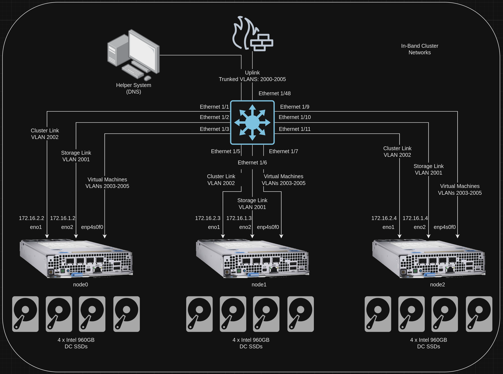

In the topology diagram, the focus will be placed on the link labeled "Virtual Machines", as that compute mode will be the primary utilization of this additional networking functionality.

The following example subnets/VLANs will be used:
| VLAN | Subnet | Description |
| --- | ---| --- |
| 2000 | 172.16.0.0/24 | Out of band management interfaces of hardware |
| 2001 | 172.16.1.0/24 | Hyperconverged storage network |
| 2002 | 172.16.2.0/23 | Cluster primary network for ingress, load balanced services, and MetalLB pools |
| 2003 | 172.16.4.0/24 | First dedicated network for bridged virtual machines |
| 2004 | 172.16.5.0/24 | Second dedicated network for bridged virtual machines |
| 2005 | 172.16.6.0/24 | Third dedicated network for bridged virtual machines |

The upstream networking devices to which the bare metal systems are connected on the "virtual machines" connection are configured as such:
```
interface Ethernet1/3
  description node0-virtualization
  switchport mode trunk
  switchport trunk allowed vlan 2003-2005

interface Ethernet1/7
  description node1-virtualization
  switchport mode trunk
  switchport trunk allowed vlan 2003-2005

interface Ethernet1/11
  description node2-virtualization
  switchport mode trunk
  switchport trunk allowed vlan 2003-2005
```

These interfaces are configured as VLAN trunks, meaning multiple VLANs can be passed over the interfaces to the connected systems. VLAN filtering is enabled, allowing VLANs 2003-2005.

The upstream firewall will be responsible for routing between subnet/VLANs.

From this configuration, the necessary configuration of the platform can be gathered. The platform must be able to:

1. Be configured to support connectivity on VLANs 2003, 2004, and 2005 on a single physical link
2. Understand incoming tagged traffic and remove the VLAN tag before presenting it to the workload
3. When traffic exits the platform networking stack, the appropriate VLAN tag must be added

The platform should handle these functions seamlessly after initial configuration.

### Connectivity Options
The platform offers multiple ways to provide this connectivity to virtual machines. This pattern covers three options:

| Option | Building Blocks | Connects To | Configuration Resources | Covered In |
| --- | --- | --- | --- | --- |
| Linux Bridges | Kernel VLAN interfaces + Linux bridges | Upstream VLANs | `NodeNetworkConfigurationPolicy`, `NetworkAttachmentDefinition` | Sections 1-4 |
| Localnet `ClusterUserDefinedNetwork` | Open vSwitch bridge + OVN localnet logical switches | Upstream VLANs | `NodeNetworkConfigurationPolicy`, `ClusterUserDefinedNetwork` | Section 6 |
| Primary Layer2 `UserDefinedNetwork`/`ClusterUserDefinedNetwork` | OVN overlay logical switch spanning all nodes | Isolated, platform-internal network | `UserDefinedNetwork` or `ClusterUserDefinedNetwork` | Section 7 |

The first two options satisfy the requirements above: virtual machines are placed directly onto VLANs 2003-2005. The third option creates isolated networks entirely within the platform, and is included because it is often the right answer for workloads that do not need to sit directly on an upstream VLAN.

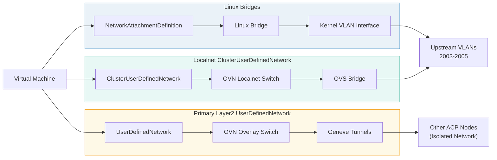

This solution is broken down into eight main areas. Sections 1-4 cover the Linux bridge option: an explanation of the platform networking, example traffic flows, configuration of the ACP's networking, and attaching an example workload (a virtual machine) to consume the new network functionality. Sections 5-8 cover user defined networks: an introduction to user defined networks, localnet `ClusterUserDefinedNetworks`, primary layer2 `UserDefinedNetworks`, and guidance on choosing and combining the connectivity models.

### Section 1 - Explanation of Platform Networking
Using a combination of VLAN interfaces and bridge interfaces, the platform can be configured to isolate and tag/untag traffic as it flows between various destinations.
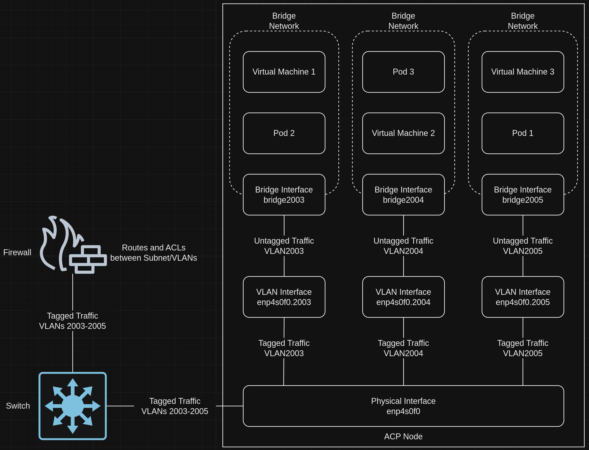

In this example, all ACP nodes have identical network configurations, so the configuration layout is identical:
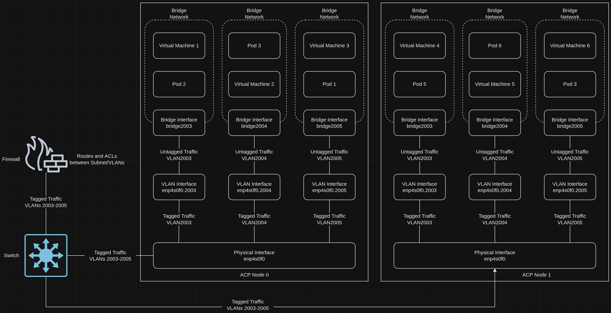

In this configuration, VLAN interfaces are created using a parent physical interface corresponding to a VLAN tag. In this example, VLAN interfaces are created for VLANs 2003, 2004, and 2005, using the same physical interface of `enp4s0f0`.

Next, Linux bridges are created using the VLAN interfaces as ports. In this example, the bridges are named according to the VLAN interface they're using as a port: `bridge2003`, `bridge2004`, and `bridge2005`, respectively.

Once the bridges are created, workloads can be attached to the bridge networks. These workloads can be virtual machines, pods, and more, however virtual machines will be used for example purposes going forward.

### Section 2 - Example Traffic Flows
The following tables give a high-level overview of how certain flows would be handled by the platform's networking capabilities in the stated configuration:

#### Virtual Machine 1 to Pod 2
Because virtual machine 1 and pod 2 are both in the same bridge network, the flow is simple:
| Step Number | Source | Destination | Device | Interface | Tagged/Untagged | Notes |
| --- | --- | --- | --- | --- | --- | --- |
| 1. | Virtual Machine 1 | Pod 2 | node0 | `bridge2003` | Untagged | Switched by Linux bridge |

#### Virtual Machine 1 to Virtual Machine 3
Now, because the virtual machines exist in different subnet/VLANs, and the firewall is responsible for routing/ACLs between the network segments, the traffic flow involves more steps, even though the workloads are on the same physical node:
| Step Number | Source | Destination | Device | Interface | Tagged/Untagged | Notes |
| --- | --- | --- | --- | --- | --- | --- |
| 1. | Virtual Machine 1 | Virtual Machine 3 | Virtual Machine 1 | `vmnic1` | Untagged | Exiting VM interface |
| 2. | Virtual Machine 1 | Virtual Machine 3 | node0 | `bridge2003` | Untagged | Exiting bridge network |
| 3. | Virtual Machine 1 | Virtual Machine 3 | node0 | `enp4s0f0.2003` | Untagged | Adding VLAN tag 2003 via VLAN interface |
| 4. | Virtual Machine 1 | Virtual Machine 3 | node0 | `enp4s0f0` | Tagged | Exiting via physical interface |
| 5. | Virtual Machine 1 | Virtual Machine 3 | Switch | `Ethernet 1/3` | Tagged | Arrives at switch |
| 6. | Virtual Machine 1 | Virtual Machine 3 | Firewall | `Uplink 1` | Tagged | Routing and ACLs evaluated/enacted, tag changed from 2003 to 2005 |
| 7. | Virtual Machine 1 | Virtual Machine 3 | Switch | `Ethernet 1/3` | Tagged | Departing switch to ACP node |
| 8. | Virtual Machine 1 | Virtual Machine 3 | node0 | `enp4s0f0` | Tagged | Entering via physical interface |
| 9. | Virtual Machine 1 | Virtual Machine 3 | node0 | `enp4s0f0.2005` | Tagged | Removing VLAN tag 2005 via VLAN interface |
| 10. | Virtual Machine 1 | Virtual Machine 3 | node0 | `bridge2005` | Untagged | Entering bridge network |
| 11. | Virtual Machine 1 | Virtual Machine 3 | Virtual Machine 3 | `vmnic1` | Untagged | Entering VM interface |

#### Virtual Machine 1 to Virtual Machine 4
This flow is simplified because the source and destination exist within the same subnet/VLAN, and thus will be switched instead of routed. The network switch will handle the switching, as the source and destination exist on different ACP nodes:
| Step Number | Source | Destination | Device | Interface | Tagged/Untagged | Notes |
| --- | --- | --- | --- | --- | --- | --- |
| 1. | Virtual Machine 1 | Virtual Machine 4 | Virtual Machine 1 | `vmnic1` | Untagged | Exiting VM interface |
| 2. | Virtual Machine 1 | Virtual Machine 4 | node0 | `bridge2003` | Untagged | Exiting bridge network |
| 3. | Virtual Machine 1 | Virtual Machine 4 | node0 | `enp4s0f0.2003` | Untagged | Adding VLAN tag 2003 via VLAN interface |
| 4. | Virtual Machine 1 | Virtual Machine 4 | node0 | `enp4s0f0` | Tagged | Exiting via physical interface |
| 5. | Virtual Machine 1 | Virtual Machine 4 | Switch | `Ethernet 1/3` | Tagged | Arrives at switch |
| 6. | Virtual Machine 1 | Virtual Machine 4 | Switch | `Ethernet 1/7` | Tagged | Departing switch to ACP node |
| 7. | Virtual Machine 1 | Virtual Machine 4 | node1 | `enp4s0f0` | Tagged | Entering via physical interface |
| 8. | Virtual Machine 1 | Virtual Machine 4 | node1 | `enp4s0f0.2003` | Tagged | Removing VLAN tag 2003 via VLAN interface |
| 9. | Virtual Machine 1 | Virtual Machine 4 | node1 | `bridge2003` | Untagged | Entering bridge network |
| 10. | Virtual Machine 1 | Virtual Machine 4 | Virtual Machine 4 | `vmnic1` | Untagged | Entering VM interface |

#### Virtual Machine 1 to Virtual Machine 6
Finally, similar to the second flow, going between virtual machines on different subnet/VLANs requires traversing the network up to the firewall then returning to a different ACP node:
| Step Number | Source | Destination | Device | Interface | Tagged/Untagged | Notes |
| --- | --- | --- | --- | --- | --- | --- |
| 1. | Virtual Machine 1 | Virtual Machine 6 | Virtual Machine 1 | `vmnic1` | Untagged | Exiting VM interface |
| 2. | Virtual Machine 1 | Virtual Machine 6 | node0 | `bridge2003` | Untagged | Exiting bridge network |
| 3. | Virtual Machine 1 | Virtual Machine 6 | node0 | `enp4s0f0.2003` | Untagged | Adding VLAN tag 2003 via VLAN interface |
| 4. | Virtual Machine 1 | Virtual Machine 6 | node0 | `enp4s0f0` | Tagged | Exiting via physical interface |
| 5. | Virtual Machine 1 | Virtual Machine 6 | Switch | `Ethernet 1/3` | Tagged | Arrives at switch |
| 6. | Virtual Machine 1 | Virtual Machine 6 | Firewall | `Uplink 1` | Tagged | Routing and ACLs evaluated/enacted, tag changed from 2003 to 2005 |
| 7. | Virtual Machine 1 | Virtual Machine 6 | Switch | `Ethernet 1/7` | Tagged | Departing switch to ACP node |
| 8. | Virtual Machine 1 | Virtual Machine 6 | node1 | `enp4s0f0` | Tagged | Entering via physical interface |
| 9. | Virtual Machine 1 | Virtual Machine 6 | node1 | `enp4s0f0.2005` | Tagged | Removing VLAN tag 2005 via VLAN interface |
| 10. | Virtual Machine 1 | Virtual Machine 6 | node1 | `bridge2005` | Untagged | Entering bridge network |
| 11. | Virtual Machine 1 | Virtual Machine 6 | Virtual Machine 6 | `vmnic1` | Untagged | Entering VM interface |

### Section 3 - Configuration of the ACP's Networking
To support this connectivity model, the ACP's network configuration service is leveraged to configure and create the necessary interfaces.

In the same way physical interfaces are configured, a declarative approach is used to create and configure the VLAN and Linux bridges.

For example, on node0, the following [NMstate](https://nmstate.io) definition would be used to create the VLAN interface and bridge associated with connectivity on VLAN2003:
```yaml
  - name: node0-vlan2003
    node: node0
    interfaces:
      # Create the VLAN interface with parent enp4s0f0
      - name: enp4s0f0.2003
        state: up
        type: vlan
        vlan:
          base-iface: enp4s0f0
          id: 2003
      # Create the linux-bridge with vlan interface enp4s0f0.2003 as a port
      - name: bridge2003
        type: linux-bridge
        state: up
        bridge:
          port:
            - name: enp4s0f0.2003
              vlan: {}
          options:
            stp:
              enabled: false
```

Once defined, the management tooling will create the appropriate resources, called a `NodeNetworkConfigurationPolicy`, which the network configuration service will consume.
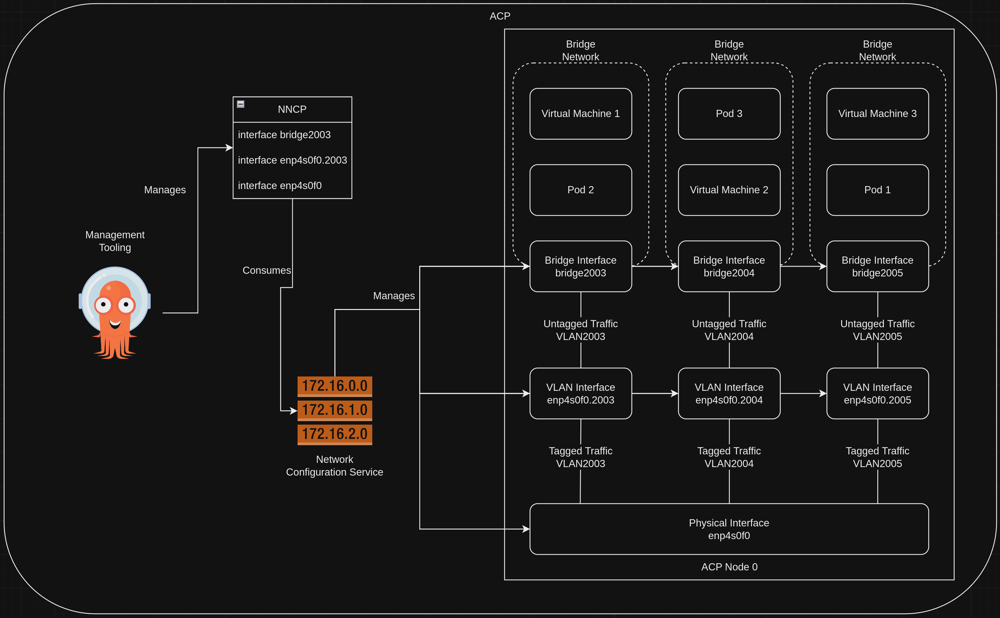

> Note:
>
> Refer to the [ACP Networking Configuration](https://github.com/RedHatEdge/patterns/tree/main/blocks/acp-network-configuration#part-4---applying-network-configurations) block for a refresher configuring and managing ACP networking.

### Section 4 - Attaching Workloads
The final step in configuring the platform is to create `NetworkAttachmentDefinition`(s), which express the intent to attach workloads to logical or physical networks.

In this example, a `NetworkAttachmentDefinition` is required for attaching workloads to VLAN2003 via `bridge2003`:
```yaml
apiVersion: k8s.cni.cncf.io/v1
kind: NetworkAttachmentDefinition
metadata:
  annotations:
    argocd.argoproj.io/sync-wave: '1'
    k8s.v1.cni.cncf.io/resourceName: bridge.network.kubevirt.io/bridge2003
  name: vlan2003
  namespace: default
  labels:
    app.kubernetes.io/instance: acp-standard-services
spec:
  config: '{
    "cniVersion": "0.3.1",
    "name": "vlan2003",
    "type": "cnv-bridge",
    "bridge": "bridge2003",
    "macspoofchk": true
    }'
```

> Note:
>
> Network attachment definitions created in the `default` namespace are available to all workloads in all namespaces. For more strict control, create them in the same namespace as the workload that requires them.

Workloads, such as virtual machines, can now be "attached" to VLAN2003, allowing for communication on that specific virtual network.
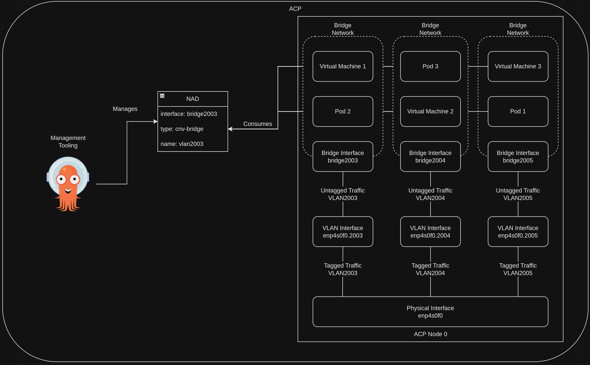

### Section 5 - Introduction to User Defined Networks
Sections 1-4 build connectivity out of kernel primitives (VLAN interfaces and Linux bridges), then expose them to workloads with manually created `NetworkAttachmentDefinitions`. User defined networks take a different approach: the platform's default network service (OVN-Kubernetes) is asked to create and manage the networks, using two custom resources:

| Resource | Scope | Created By | Namespace Targeting | Supported Topologies | Supported Roles |
| --- | --- | --- | --- | --- | --- |
| `UserDefinedNetwork` | Namespaced | Namespace administrators | Only the namespace the resource is created in | `Layer2`, `Layer3` | `Primary`, `Secondary` |
| `ClusterUserDefinedNetwork` | Cluster | Cluster administrators | Any namespaces matching a `namespaceSelector` | `Layer2`, `Layer3`, `Localnet` | `Primary`, `Secondary` (`Localnet` is `Secondary` only) |

In both cases, the network service automatically generates a `NetworkAttachmentDefinition` in each targeted namespace, with the same name as the user defined network. These generated definitions are owned by the network service, and are kept in sync as namespaces are added or removed from the selector.

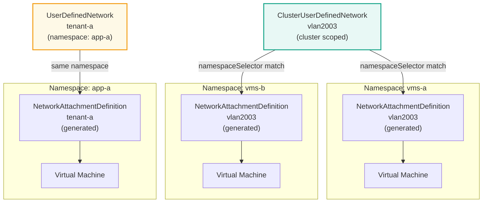

User defined networks are built from a topology and a role. The topology describes how the network is built:
| Topology | Description | Requires Node Network Configuration | Virtual Machine Support | Live Migration |
| --- | --- | --- | --- | --- |
| `Layer2` | A single logical switch spanning all nodes. Traffic between nodes is encapsulated (Geneve) over the cluster network. | No | Yes | Yes, with persistent IP addresses |
| `Layer3` | A logical switch per node, with a logical router between them. Each node receives a slice of the subnet. | No | No | N/A |
| `Localnet` | A logical switch connected to a physical network via an Open vSwitch bridge mapping, optionally on a VLAN. | Yes | Yes | Yes |

The role describes how the network is presented to the workload:
| Role | Description | Interface in Workload | Default Pod Network |
| --- | --- | --- | --- |
| `Primary` | Replaces the default pod network for all workloads in the namespace | The default/first interface | Isolated from workloads; only used by the platform for health probes |
| `Secondary` | An additional network attached alongside the workload's primary network | An additional interface | Unchanged |

For virtual machines, two combinations are the most relevant, and are covered in the following sections:
| Combination | Use Case | Section |
| --- | --- | --- |
| `ClusterUserDefinedNetwork` + `Localnet` + `Secondary` | Placing virtual machines directly onto upstream VLANs, an alternative to Sections 1-4 | Section 6 |
| `UserDefinedNetwork`/`ClusterUserDefinedNetwork` + `Layer2` + `Primary` | Placing virtual machines onto isolated, platform-internal networks | Section 7 |

### Section 6 - Localnet ClusterUserDefinedNetworks
A localnet `ClusterUserDefinedNetwork` provides the same end result as Sections 1-4: virtual machines sit directly on VLANs 2003, 2004, and 2005, and the upstream firewall routes between them. The difference is in how the platform builds the connectivity.

Instead of one VLAN interface and one Linux bridge per VLAN on each node, a single Open vSwitch (OVS) bridge is created with `enp4s0f0` as a port, and is given a "physical network name" via a bridge mapping. Each `ClusterUserDefinedNetwork` then references that physical network name and a VLAN ID, and the network service creates a logical switch that adds/removes the VLAN tag as traffic enters and leaves the OVS bridge.

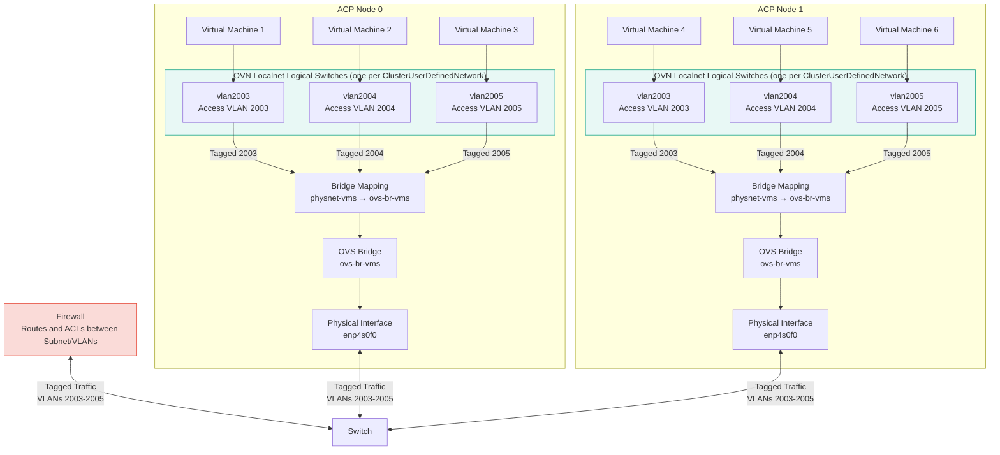

The components from Sections 1-4 map to localnet equivalents as follows:
| Linux Bridge Component | Localnet Equivalent | Notes |
| --- | --- | --- |
| VLAN interface (`enp4s0f0.2003`) | `spec.network.localnet.vlan.access.id: 2003` on the `ClusterUserDefinedNetwork` | Tagging is handled by OVS instead of a kernel VLAN interface |
| Linux bridge (`bridge2003`) | OVN localnet logical switch for `vlan2003` | Created automatically by the network service |
| One `NodeNetworkConfigurationPolicy` per VLAN, per node | One OVS bridge and bridge mapping per node, regardless of VLAN count | Adding a VLAN no longer requires node network changes |
| Manually created `NetworkAttachmentDefinition` | Generated `NetworkAttachmentDefinition` in each selected namespace | Access is controlled by the `namespaceSelector` |
| `cnv-bridge` CNI plugin | `ovn-k8s-cni-overlay` CNI plugin | Virtual machines use the same `bridge` binding in both cases |

#### Example Traffic Flow - Virtual Machine 1 to Virtual Machine 3
The traffic flow mirrors the Linux bridge flow from Section 2, with OVS performing the tagging instead of kernel VLAN interfaces:
| Step Number | Source | Destination | Device | Interface | Tagged/Untagged | Notes |
| --- | --- | --- | --- | --- | --- | --- |
| 1. | Virtual Machine 1 | Virtual Machine 3 | Virtual Machine 1 | `vmnic1` | Untagged | Exiting VM interface |
| 2. | Virtual Machine 1 | Virtual Machine 3 | node0 | `vlan2003` logical switch | Untagged | Exiting localnet logical switch |
| 3. | Virtual Machine 1 | Virtual Machine 3 | node0 | `ovs-br-vms` | Tagged | VLAN tag 2003 added via bridge mapping `physnet-vms` |
| 4. | Virtual Machine 1 | Virtual Machine 3 | node0 | `enp4s0f0` | Tagged | Exiting via physical interface |
| 5. | Virtual Machine 1 | Virtual Machine 3 | Switch | `Ethernet 1/3` | Tagged | Arrives at switch |
| 6. | Virtual Machine 1 | Virtual Machine 3 | Firewall | `Uplink 1` | Tagged | Routing and ACLs evaluated/enacted, tag changed from 2003 to 2005 |
| 7. | Virtual Machine 1 | Virtual Machine 3 | Switch | `Ethernet 1/3` | Tagged | Departing switch to ACP node |
| 8. | Virtual Machine 1 | Virtual Machine 3 | node0 | `enp4s0f0` | Tagged | Entering via physical interface |
| 9. | Virtual Machine 1 | Virtual Machine 3 | node0 | `ovs-br-vms` | Tagged | Matched to the `vlan2005` logical switch by VLAN tag |
| 10. | Virtual Machine 1 | Virtual Machine 3 | node0 | `vlan2005` logical switch | Untagged | VLAN tag 2005 removed, entering localnet logical switch |
| 11. | Virtual Machine 1 | Virtual Machine 3 | Virtual Machine 3 | `vmnic1` | Untagged | Entering VM interface |

#### Configuring the Nodes
Because all ACP nodes have identical network configurations, a single `NodeNetworkConfigurationPolicy` can create the OVS bridge and bridge mapping on every node:
```yaml
apiVersion: nmstate.io/v1
kind: NodeNetworkConfigurationPolicy
metadata:
  name: ovs-br-vms
  annotations:
    argocd.argoproj.io/sync-wave: "3"
    argocd.argoproj.io/sync-options: SkipDryRunOnMissingResource=true
spec:
  nodeSelector:
    node-role.kubernetes.io/worker: ""
  desiredState:
    interfaces:
      # Create an OVS bridge with enp4s0f0 as a port
      - name: ovs-br-vms
        type: ovs-bridge
        state: up
        bridge:
          # Allow OVN to add its patch ports to the bridge
          allow-extra-patch-ports: true
          options:
            stp: false
          port:
            - name: enp4s0f0
    ovn:
      # Map the physical network name to the OVS bridge
      bridge-mappings:
        - localnet: physnet-vms
          bridge: ovs-br-vms
          state: present
```

> Note:
>
> The [ACP Networking Configuration](../../blocks/acp-network-configuration/README.md#part-4---applying-network-configurations) block's template only renders the `interfaces` section of a policy. To manage bridge mappings with the same tooling, extend the template to also render an `ovn` section.

> Note:
>
> A physical interface should be used by either Linux bridges (Sections 1-4) or an OVS bridge (this section), not both. Choose one model per physical interface.

#### Creating the Networks
With the nodes configured, a `ClusterUserDefinedNetwork` is created for each VLAN. In this example, the network for VLAN2003 is made available to any namespace with the label `vlan-access-2003: "true"`:
```yaml
apiVersion: k8s.ovn.org/v1
kind: ClusterUserDefinedNetwork
metadata:
  name: vlan2003
  annotations:
    argocd.argoproj.io/sync-wave: '1'
spec:
  namespaceSelector:
    matchLabels:
      vlan-access-2003: "true"
  network:
    topology: Localnet
    localnet:
      role: Secondary
      # Must match the localnet name in the bridge mapping
      physicalNetworkName: physnet-vms
      vlan:
        mode: Access
        access:
          id: 2003
      # IP addressing handled by upstream DHCP or static assignment
      ipam:
        mode: Disabled
```

The networks for VLANs 2004 and 2005 are identical, apart from the name, label, and VLAN ID. No node changes are needed to add them.

The `ipam` setting determines who is responsible for IP addressing:
| `ipam.mode` | `subnets` | IP Address Assignment | Typical Use |
| --- | --- | --- | --- |
| `Disabled` | Must not be set | Upstream DHCP server, or static configuration within the virtual machine | Existing VLANs with existing DHCP/IPAM, matching Sections 1-4 |
| `Enabled` | Required | Network service assigns addresses from `subnets` (minus `excludeSubnets`); `lifecycle: Persistent` keeps them stable for virtual machines | VLANs where the platform owns addressing |

> Note:
>
> When `ipam.mode` is `Enabled`, use `excludeSubnets` to reserve addresses already in use on the VLAN, such as the firewall's gateway address.

#### Attaching Virtual Machines
Virtual machines in a selected namespace reference the generated `NetworkAttachmentDefinition` by name, using the `bridge` binding, the same as with Linux bridges:
```yaml
spec:
  template:
    spec:
      domain:
        devices:
          interfaces:
            - name: default
              masquerade: {}
            - name: vlan2003
              bridge: {}
              model: virtio
      networks:
        - name: default
          pod: {}
        - name: vlan2003
          multus:
            networkName: vlan2003
```

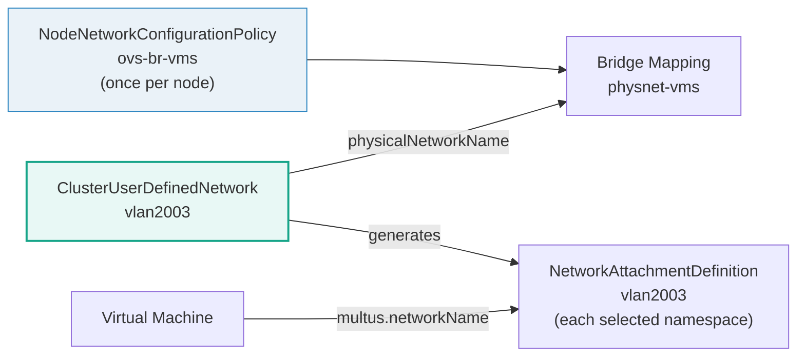

### Section 7 - Primary Layer2 UserDefinedNetworks
Not every virtual machine needs to sit on an upstream VLAN. Sometimes the requirement is only that a group of virtual machines can talk to each other on a flat layer 2 network, isolated from everything else on the platform, with stable IP addresses. Traditionally this would mean asking for a new VLAN on the upstream network.

A primary layer2 user defined network meets this requirement entirely within the platform. The network service creates a logical switch spanning all ACP nodes. Traffic between virtual machines on different nodes is encapsulated (Geneve) and carried over the cluster network (VLAN 2002), so no upstream network changes are needed. Each user defined network is isolated from the default pod network and from every other user defined network. Different networks can even use overlapping subnets.

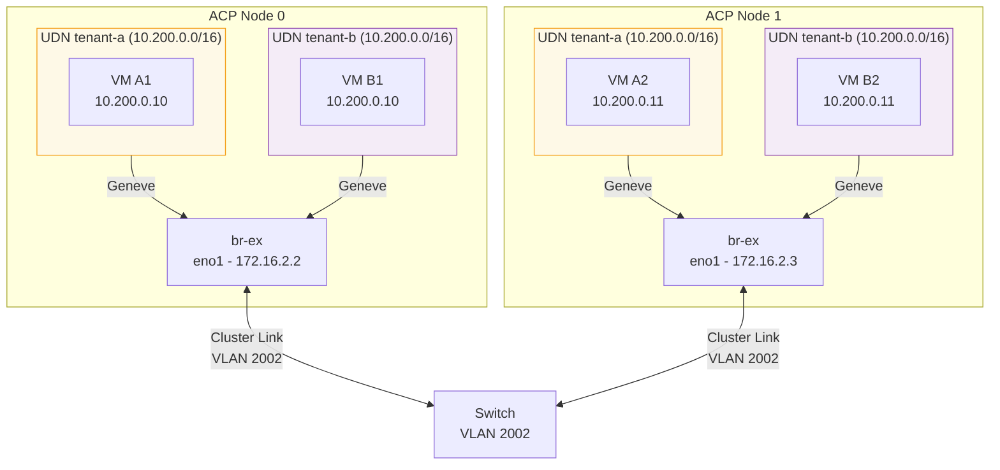

In the diagram, VM A1 and VM A2 share the `tenant-a` network, and VM B1 and VM B2 share the `tenant-b` network. Both networks use the same subnet, and even the same IP addresses, without conflict, because they are separate logical networks.

Key characteristics of primary layer2 user defined networks for virtual machines:
| Characteristic | Behavior |
| --- | --- |
| Node network configuration | None required; uses the existing cluster network |
| Upstream network configuration | None required |
| IP address assignment | Network service IPAM, served to the virtual machine via DHCP |
| IP address persistence | With `ipam.lifecycle: Persistent`, addresses survive restarts and live migration |
| Live migration | Supported; the virtual machine keeps its IP address and MAC address |
| Isolation | Isolated from the default pod network and all other user defined networks |
| East/west traffic | Switched within the logical switch; between nodes, encapsulated over the cluster network |
| Egress (outbound) traffic | Source NAT to the node's IP on the cluster network (`172.16.2.0/23`), then routed by the firewall |
| Ingress (inbound) traffic | Through platform services, such as `LoadBalancer` services from the load balancing service; the network's addresses are not directly routable from the upstream network |
| Network policy | Standard `NetworkPolicy` resources apply |
| Virtual machine binding | `l2bridge` binding on the primary (pod) network |

#### Example Traffic Flows
##### VM A1 to VM A2 (Same Network, Different Nodes)
| Step Number | Source | Destination | Device | Interface | Encapsulation | Notes |
| --- | --- | --- | --- | --- | --- | --- |
| 1. | VM A1 | VM A2 | VM A1 | `eth0` | None | Exiting VM interface |
| 2. | VM A1 | VM A2 | node0 | `tenant-a` logical switch | None | Destination is on node1 |
| 3. | VM A1 | VM A2 | node0 | `br-int` | Geneve | Encapsulated, tagged with the `tenant-a` network identifier |
| 4. | VM A1 | VM A2 | node0 | `br-ex` / `eno1` | Geneve | Exiting via cluster link, `172.16.2.2` to `172.16.2.3` |
| 5. | VM A1 | VM A2 | Switch | `Ethernet 1/1` to `Ethernet 1/5` | Geneve | Switched on VLAN 2002, no routing required |
| 6. | VM A1 | VM A2 | node1 | `br-ex` / `eno1` | Geneve | Entering via cluster link |
| 7. | VM A1 | VM A2 | node1 | `br-int` | None | Decapsulated, delivered to the `tenant-a` logical switch |
| 8. | VM A1 | VM A2 | VM A2 | `eth0` | None | Entering VM interface |

##### VM A1 to VM B1 (Different Networks, Same Node)
| Step Number | Source | Destination | Device | Interface | Encapsulation | Notes |
| --- | --- | --- | --- | --- | --- | --- |
| 1. | VM A1 | VM B1 | VM A1 | `eth0` | None | Exiting VM interface |
| 2. | VM A1 | VM B1 | node0 | `tenant-a` logical switch | None | No path to `tenant-b`; `10.200.0.10` resolves to VM A1's own network only |

##### VM A1 to an Upstream System (172.16.4.50 on VLAN 2003)
| Step Number | Source | Destination | Device | Interface | Encapsulation | Notes |
| --- | --- | --- | --- | --- | --- | --- |
| 1. | VM A1 | 172.16.4.50 | VM A1 | `eth0` | None | Exiting VM interface |
| 2. | VM A1 | 172.16.4.50 | node0 | `tenant-a` logical switch | None | Sent to the network's gateway |
| 3. | VM A1 | 172.16.4.50 | node0 | `br-ex` / `eno1` | None | Source NAT from `10.200.0.10` to `172.16.2.2` |
| 4. | VM A1 | 172.16.4.50 | Switch | `Ethernet 1/1` | None | Arrives at switch on VLAN 2002 |
| 5. | VM A1 | 172.16.4.50 | Firewall | `Uplink 1` | None | Routing and ACLs evaluated/enacted, VLAN 2002 to 2003 |
| 6. | VM A1 | 172.16.4.50 | Switch | `Ethernet 1/48` | None | Arrives back at switch on VLAN 2003, switched to destination |

#### Creating the Network
A primary user defined network must be in place before any workloads are created in the namespace. Its namespace must also carry the `k8s.ovn.org/primary-user-defined-network` label when the namespace is created; the label cannot be added to an existing namespace.
```yaml
apiVersion: v1
kind: Namespace
metadata:
  name: app-a
  labels:
    # Must be present at namespace creation
    k8s.ovn.org/primary-user-defined-network: ""
---
apiVersion: k8s.ovn.org/v1
kind: UserDefinedNetwork
metadata:
  name: tenant-a
  namespace: app-a
spec:
  topology: Layer2
  layer2:
    role: Primary
    subnets:
      - 10.200.0.0/16
    ipam:
      # Keep virtual machine IP addresses across restarts and live migration
      lifecycle: Persistent
```

When the same isolated network should span multiple namespaces, for example an application split into frontend and backend namespaces, a `ClusterUserDefinedNetwork` is used instead:
```yaml
apiVersion: k8s.ovn.org/v1
kind: ClusterUserDefinedNetwork
metadata:
  name: tenant-a
spec:
  namespaceSelector:
    matchExpressions:
      - key: kubernetes.io/metadata.name
        operator: In
        values:
          - app-a-frontend
          - app-a-backend
  network:
    topology: Layer2
    layer2:
      role: Primary
      subnets:
        - 10.200.0.0/16
      ipam:
        lifecycle: Persistent
```

#### Attaching Virtual Machines
Because the network is the primary network for the namespace, virtual machines attach to it through their default `pod` network, using the `l2bridge` binding:
```yaml
spec:
  template:
    spec:
      domain:
        devices:
          interfaces:
            - name: default
              binding:
                name: l2bridge
      networks:
        - name: default
          pod: {}
```

> Note:
>
> The virtual machine receives its address from the network service via DHCP, so the guest operating system should be configured for DHCP on its primary interface.

### Section 8 - Choosing and Combining Connectivity Models
The connectivity models are not mutually exclusive at the platform level. Different namespaces can use different models, and a single virtual machine can combine a primary user defined network with secondary interfaces on upstream VLANs.

| Consideration | Linux Bridges (Sections 1-4) | Localnet `ClusterUserDefinedNetwork` (Section 6) | Primary Layer2 `UserDefinedNetwork` (Section 7) |
| --- | --- | --- | --- |
| Places VMs directly on upstream VLANs | Yes | Yes | No |
| Upstream network changes per new network | VLAN must exist and be trunked | VLAN must exist and be trunked | None |
| Node network changes per new network | New VLAN interface and bridge on every node | None, after initial OVS bridge | None |
| VLAN tagging performed by | Kernel VLAN interfaces | Open vSwitch | N/A (Geneve encapsulation) |
| Attachment resource | Manually created `NetworkAttachmentDefinition` | Generated by the network service | Generated by the network service |
| Namespace access control | Namespace of the `NetworkAttachmentDefinition` (`default` exposes it to all) | `namespaceSelector` | The namespace itself (or a `namespaceSelector` with a `ClusterUserDefinedNetwork`) |
| IP address management | Upstream DHCP or static | Upstream DHCP/static, or platform IPAM | Platform IPAM with persistent addresses |
| Routing between networks | Upstream firewall | Upstream firewall | Isolated; egress via source NAT to the upstream firewall |
| Reachable directly from the upstream network | Yes | Yes | No, via platform services |
| Network policy | `MultiNetworkPolicy` | `MultiNetworkPolicy` | `NetworkPolicy` |
| Live migration | Yes | Yes | Yes, with persistent IP addresses |
| Interface/binding in VM | Secondary, `bridge` binding | Secondary, `bridge` binding | Primary, `l2bridge` binding |

The following decision flow can help select a connectivity model for a given workload:
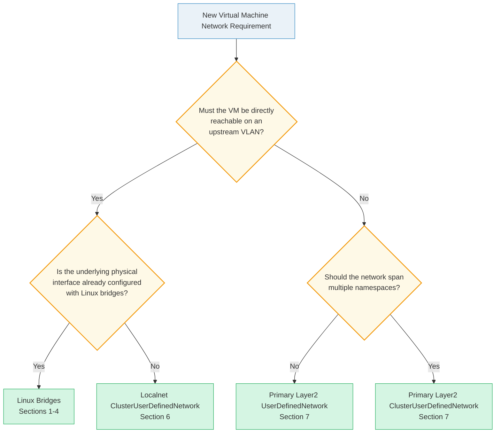

#### Combining Models
A common combination is a virtual machine that lives on an isolated primary layer2 network for application traffic, with a secondary interface on an upstream VLAN for a specific purpose, such as reaching a legacy system or a management network:
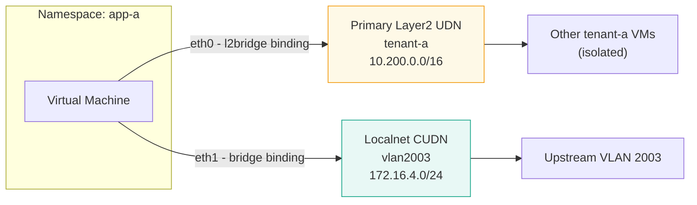

In this example, the `app-a` namespace would need the `k8s.ovn.org/primary-user-defined-network` label at creation, and the `vlan-access-2003: "true"` label to be selected by the `vlan2003` `ClusterUserDefinedNetwork`:
```yaml
spec:
  template:
    spec:
      domain:
        devices:
          interfaces:
            - name: default
              binding:
                name: l2bridge
            - name: vlan2003
              bridge: {}
              model: virtio
      networks:
        - name: default
          pod: {}
        - name: vlan2003
          multus:
            networkName: vlan2003
```

## Resulting Context
The resulting context is the ability to support workloads, such as virtual machines, running in different virtualized network segments, leveraging the same physical interfaces. This allows for alignment to existing network topologies, and if desired, isolation of specific workloads to specific network segments.

With user defined networks, the platform can additionally provide upstream VLAN connectivity through declarative, namespace-scoped `ClusterUserDefinedNetworks`, and isolated, platform-internal virtual machine networks with persistent addressing through primary layer2 `UserDefinedNetworks`, without requiring changes to the upstream network.

## Examples
A common example for this connectivity model is running virtual machines that are spread out across different VLANs on the same platform, without needing physical network connections for each network segment.

Instead of using the `masquerade`/default network configuration for virtual machines, which uses the cluster's internal networking stack, the virtual machines can be bridged directly onto the network, which is the connectivity model more commonly expected for traditional virtualized workloads.

Virtual machines created using the virtualization service of the platform can be modified at creation or after deployment to consume this new connectivity functionality:
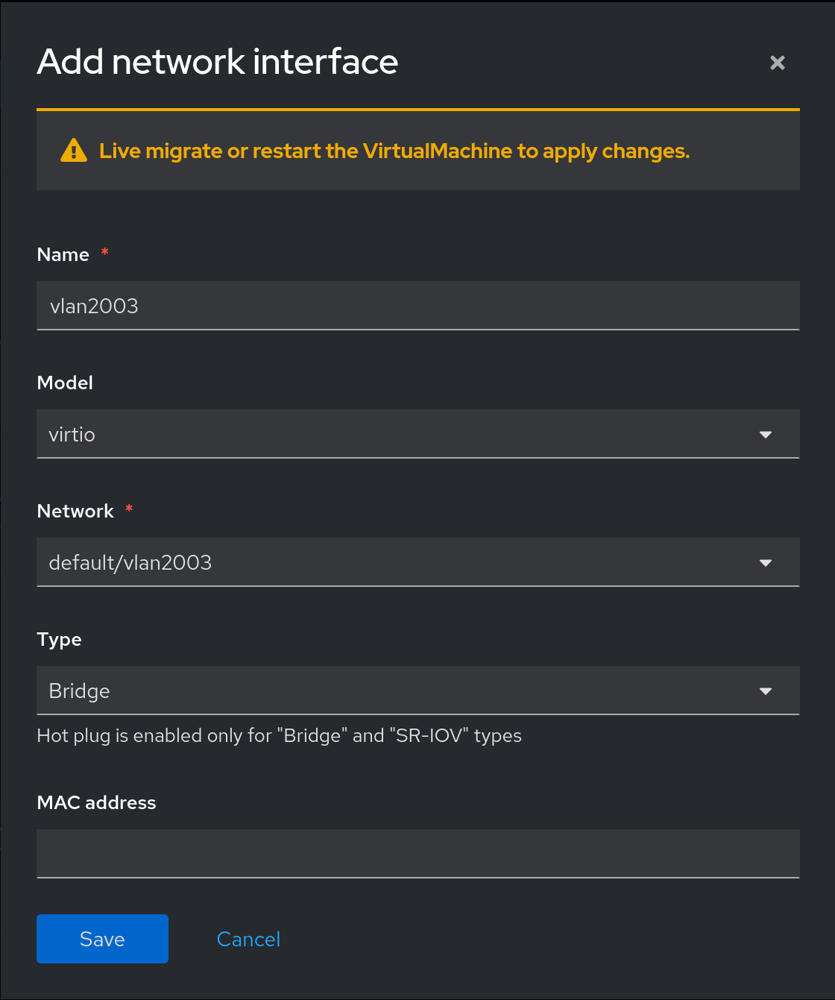

Once the interface has been added, if DHCP is available, the virtual machine will receive a lease. If DHCP is not available, the interface can be configured with a static address.
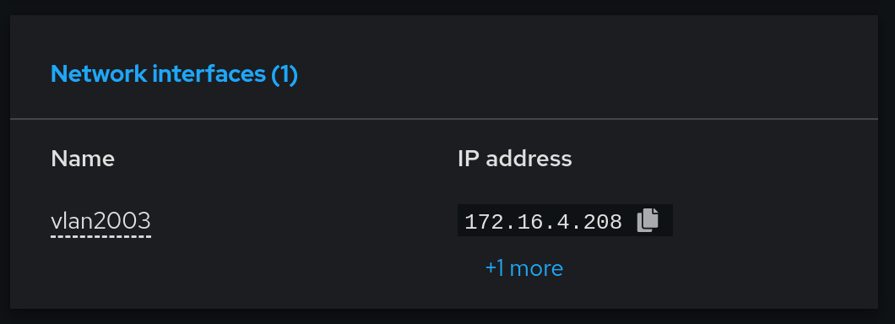

This address is reachable on the network, using the newly configured network connectivity functionality:
```
ping 172.16.4.208
PING 172.16.4.208 (172.16.4.208) 56(84) bytes of data.
64 bytes from 172.16.4.208: icmp_seq=1 ttl=63 time=4.29 ms
64 bytes from 172.16.4.208: icmp_seq=2 ttl=63 time=3.79 ms
64 bytes from 172.16.4.208: icmp_seq=3 ttl=63 time=3.76 ms
64 bytes from 172.16.4.208: icmp_seq=4 ttl=63 time=3.70 ms
64 bytes from 172.16.4.208: icmp_seq=5 ttl=63 time=3.65 ms
^C
--- 172.16.4.208 ping statistics ---
5 packets transmitted, 5 received, 0% packet loss, time 4008ms
rtt min/avg/max/mdev = 3.645/3.837/4.294/0.233 ms
```

The same result can be achieved with a localnet `ClusterUserDefinedNetwork`. Once the `vlan2003` network from Section 6 exists, labeling a namespace makes the network available to virtual machines in that namespace, with no additional node or attachment definition configuration:
```
oc label namespace vms-a vlan-access-2003=true
oc get network-attachment-definitions -n vms-a
```

The generated `vlan2003` attachment definition appears in the namespace, and virtual machines can select it when adding an interface, the same as with Linux bridges.

A second common example is a multi-tier application, such as a web frontend, application server, and database, that needs its virtual machines on a shared layer 2 network, isolated from other applications, with addresses that do not change. Instead of requesting a new VLAN from the network team, a primary layer2 `UserDefinedNetwork` is created alongside the application's namespace, as shown in Section 7. The virtual machines receive addresses from the network service, keep them through restarts and live migrations, and only the frontend is exposed to the upstream network through a `LoadBalancer` service.

## Rationale
The rationale for this pattern is to support the current predominant connectivity model for virtual machines and their workloads. This pattern also does not require specialized hardware or NICs to enable, since it uses native kernel functionality, making it broadly applicable.

User defined networks are included as they represent the platform's direction for virtual machine networking: localnet `ClusterUserDefinedNetworks` provide the same upstream VLAN connectivity with less per-node configuration and namespace-level access control, while primary layer2 `UserDefinedNetworks` give virtual machines isolated, migration-friendly networks without any dependency on the upstream network.

## Footnotes

### Version
1.2.0

### Authors
- Josh Swanson (jswanson@redhat.com)


## For AI Agents
For a complete catalog of all blocks and patterns with prerequisite relationships, see [`index.yaml`](../../index.yaml).

```yaml
title: Bridging Virtual Machines Directly to a Network
type: pattern
description: Attaching virtual machines on an ACP directly to VLANs using bridged networking or localnet ClusterUserDefinedNetworks, and to isolated networks using primary layer2 UserDefinedNetworks
platform: Red Hat OpenShift
scope: Virtualization
tooling: [Red Hat OpenShift GitOps]
prerequisites:
  blocks: [example-network-config, acp-network-configuration, acp-bridged-networks]
  patterns: [acp-standardized-architecture-ha]
status: complete
```
